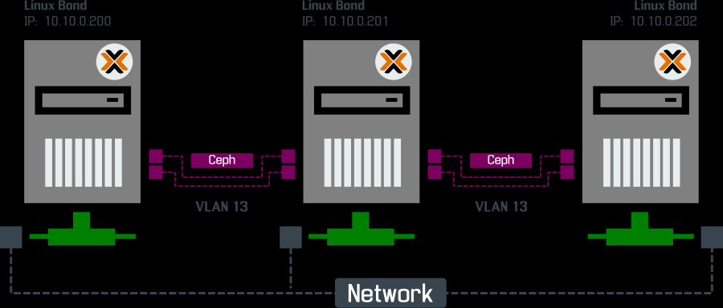
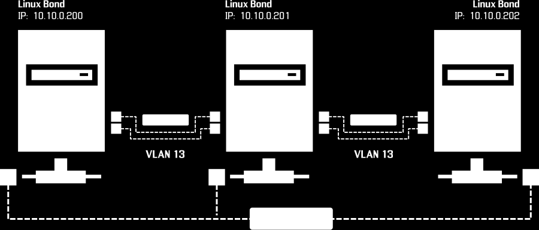

# CC531-parcial-20262.pdf

## Escuela de Ciencia de la Computación

## Examen Parcial

## CC531 A Análisis en Macrodatos 2026-2

Parte 1 [6 pts]: Resolver en el laboratorio de clase de forma presencial 6 preguntas de teoría de forma individual, en hoja y con lapicero, abarca todos los temas hasta el parcial.

Parte 2 [14 pts]: Se pide configurar y programar un Clúster de Hadoop e instalar Hadoop multimodo 1 maestro y 2 o más esclavos, en máquinas virtuales mínima de Ubuntu siguiendo el tutorial y demostración presentado en clase, Desarrollar un informe, Una presentación y Exponer sobre una base de datos para su Análisis según las siguientes restricciones:

Implementar: • Implementar un Clúster de Hadoop e instalar Hadoop multimodo 1 maestro y 2 o más esclavos, en máquinas virtuales de Ubuntu o Windows usando virtual box u otro virtualizador a su criterio. Es estrictamente necesario que la implementación sea mediante máquinas virtuales.

• Elaborar un informe en el cual:

o Adicional a las secciones de siempre, crear una sección inicial de implementación donde se describirá a grandes rasgos los pasos seguidos con capturas de la configuración. o Adjuntando las capturas de pantalla de cada paso de configuración y la pantalla final donde aparecen los nodos conectados.

• Implementar o usar su VM de un nodo para que comparen rendimientos en los trabajos realizados.

• Buscar un Dataset de la Plataforma Nacional de Datos Abiertos (PNDA) que no haya sido expuesto en las PC por ningún grupo (base de datos) y que sea de las categorías TRANSPORTE Y MOVILIDAD O VIVIENDA URBANISMO O TERRITORIO, el cual debe tener los campos de latitud y longitud. Revisar en el cuadro de temas los ya utilizados por los otros grupos, no se admitirá datasets repetidos ni con muestras de datos en diferentes periodos.

• Tanto en el informe como en la presentación:

o Referenciar la base de datos usada.

o Referencias investigaciones anteriores realizadas a la base datos.

o Indicar la fuente de dataset y la fecha de publicación, se tomará en cuenta las bases de datos más recientes.

o Referenciar artículos que usaron su dataset si lo hubiera hecho.

• Implementar Consultas de complejidad en Hadoop

o Hacer 2 consultas con decimales que implique al menos un Mapreduce triple. Cada consulta por separado debe tener el Mapreduce triple como se vio en clase.

o Implementar 1 consulta que implemente un algoritmo de agrupamiento (a excepción de K-means) basado íntegramente en Hadoop Mapreduce sobre las coordenadas geográficas.

o Implementar 2 consultas con campos decimales o cadenas que implementen 2 modelos de multilayer perceptrón, 1 de clasificación y 1 de regresión, usando el concepto clásico de gradiente descendiente en Hadoop Mapreduce.

• Correr su código en el clúster implementado y en la versión de un solo nodo (El que implementaron para la PC1).

• Implementar una tabla de comparación que mida: Los tiempos de ejecución, el speedup, uso promedio de CPU y memoria en paralelo y en un solo nodo. La tabla y explicación de la razón de las salidas debe estar en el informe y en la presentación.

• Adicionar en el informe la imagen del monitor de recursos de la ejecución en paralelo (ejemplo htop) de memoria, de cada procesador, y tiempos de ejecución de cada caso de los nodos en la red, para observar el paralelismo de los procesos.

• Para el caso de las preguntas de Machine learning elaborar una tabla donde se compare las métricas de perdida, accuracy y otras medidas propias que elijan para cada modelo en los casos paralelos y 1 solo nodo, para compararlos.

• De igual forma hacer una tabla comparativa de métricas de evaluación del agrupamiento como Silhouette Score o Davies-Bouldin Index aplicados en cluster y 1 solo nodo.

• En el informe y presentación para mantener la organización por cada consulta se debe mencionar:

o Especificar el tipo de pregunta o grupo de pregunta.

o Mencionar la consulta en el Dataset a la cual responde. Ejem: “Cual es el promedio de marcas usadas…”

o Explicar la solución y resultados.

• Agregar al informe y presentación los inputs y outputs que pudiera tener sus consultas.

• Con los resultados obtenidos de las consultas implementar gráficos usando Power BI y adjuntarlos a su informe y presentación. Al menos un gráfico que use las coordenadas geográficas y los resultados del agrupamiento.

• Durante la exposición se debe mostrar la ejecución del clúster implementado distribuido y el de un solo nodo.

Entregables: • Utilizar las plantillas adjuntas en la tarea. • Códigos con la extensión JAVA y los JAR (obligatorio) • Informe y presentación (Obligatorio) • El dataset utilizado. • Imágenes y fuente del powerBI. (Obligatorio) • Cada miembro del grupo deberá entrega lo antes mencionado en un zip por el aula virtual.

Observaciones importantes:

• Está prohibido que dos o más grupos utilicen el mismo dataset incluso con rango de fechas o sub-partes diferentes, de presentarse el caso no se evaluará a ningún de los grupos involucrados. • El tiempo límite de exposición es de 10 minutos, de pasarse ese tiempo o hacer bulla o

distracción en el aula se aplicarán descuento de puntos. • Todos los entregables deben presentarse como máximo hasta la fecha establecida en el aula virtual. No se darán plazo adicional de entrega. • De no presentarse todo entregable calificado como obligatorio, dado que son componentes básicos para demostrar el trabajo realizado, no se evaluará dicho trabajo o se colocará un puntaje en base a lo que pueda ser verificado. • La cantidad de participantes por grupo será de 1 a 3 personas como máximo. • Es obligatoria que la implementación del clúster sea usando máquinas virtuales y que los algoritmos de agrupamiento y ML sean implementados íntegramente usando MapReduce no se admitirán otras librerías de ayuda relacionadas. • Todos los miembros del grupo deben estar presentes durante la exposición, si un participante no viene a exponer no se le considerará la nota.
