# PARCIAL – CC531 Análisis en Macrodatos 2026-2

- Enunciado: [`CC531-parcial-20262.pdf`](CC531-parcial-20262.pdf)  
- Grupo 9 – Flores Villar Esaú – Jose Manuel Montalvo Espinoza  
- ISO de las VM: `ubuntu-26.04.1-live-server-amd64.iso` (https://releases.ubuntu.com/26.04/); no se versiona por su tamaño (2.8 GB)  

## Dataset: Reportes preliminares de Accidentes – Centro de Gestión y Monitoreo

| Campo | Valor |
| --- | --- |
| URL | https://www.datosabiertos.gob.pe/dataset/reportes-preliminares-de-accidentes-centro-de-gesti%C3%B3n-y-monitoreo |
| Categoría PNDA | Transporte y movilidad |
| Publicador | Superintendencia de Transporte Terrestre de Personas, Carga y Mercancías – SUTRAN (Subgerencia de Supervisión Electrónica) |
| Fecha de lanzamiento | 2021-12-17 |
| Fecha modificada | 2022-01-28 |
| Frecuencia declarada | Trimestral (Quarterly) |
| Cobertura | Perú |
| Licencia | Open Data Commons Attribution License |
| Contacto | sgse@sutran.gob.pe |

Descripción (PNDA): la Subgerencia de Supervisión Electrónica, según el ROF de SUTRAN, es la unidad orgánica responsable del monitoreo permanente de los eventos o incidencias que se presentan en las vías de competencia de la SUTRAN.

### Archivos en `dataset_accidentes_cgm/`

| Archivo | Origen |
| --- | --- |
| `dataSSE_17122021_c.csv` | Descarga original de la PNDA (ISO-8859-1, separador `;`, fin de línea CRLF) |
| `dataSSE_17122021_c_utf8.csv` | Copia convertida a UTF-8 con fin de línea LF (`iconv` + `tr -d '\r'`), mismo contenido |
| `Formato_2_Diccionario_de_datos SSE.doc` | Diccionario de datos original de la PNDA |
| `Formato_2_Diccionario_de_datos SSE.docx` / `.docx.md` | Conversión con LibreOffice y luego `docx_to_md.py` |
| `leydigital.pdf` / `.pdf.md` | Norma adjunta por la PNDA (D. Leg. 1412, Ley de Gobierno Digital); genérica, no específica del dataset |

### Diccionario de datos

| Campo | Descripción | Tipo |
| --- | --- | --- |
| FECHA_CORTE | Fecha de corte (AAAAMMDD) | Numérico |
| NRO_REPORTE | Número de reporte / código único | Alfanumérico |
| FECHA_ACC | Fecha del accidente (AAAAMMDD) | Numérico |
| HORA_ACC | Hora del accidente (24 h) | Hora |
| MODALIDAD_ACC | Modalidad del accidente ("ESPECIAL" = atípico: caída de piedras, desprendimiento de llanta, etc.) | Texto |
| CANT_FALLECIDOS | Número de fallecidos | Numérico |
| CANT_HERIDOS | Número de heridos | Numérico |
| LATITUD | Latitud del accidente | Decimal |
| LONGITUD | Longitud del accidente | Decimal |
| PROGRESIVA | Kilómetro de la vía | Decimal |
| CODIGO_VIA | Código MTC de la vía (red nacional, departamental o vecinal) | Texto |
| DEPARTAMENTO / PROVINCIA / DISTRITO | Ubicación administrativa | Texto |

### Perfil del CSV

- 3 832 filas × 14 columnas; `NRO_REPORTE` sin duplicados.
- Periodo: `FECHA_ACC` de 2020-01-01 a 2021-11-30; `FECHA_CORTE` única = 20211130.
- Coordenadas: sin nulos ni ceros, todas dentro de Perú (lat −18.27 a −3.52, lon −81.28 a −69.05); 3 686 puntos únicos.
- Nulos: `PROGRESIVA` 80, `CODIGO_VIA` 31; el resto completo.
- `PROGRESIVA`: 0 a 1 814 km, mediana 146.25.
- `CANT_FALLECIDOS`: 0 a 33, media 0.29 (3 172 filas en 0). `CANT_HERIDOS`: 0 a 71, media 1.44 (1 962 filas en 0).
- `MODALIDAD_ACC` (8 clases): CHOQUE 1 967, DESPISTE 1 562, ATROPELLO 94, VOLCADURA 80, INCENDIO 65, ESPECIAL 44, ACCIDENTE 11, EMBISTE 9.
- `DEPARTAMENTO`: 25 valores (LIMA 872, AREQUIPA 468, JUNIN 317, ANCASH 285, ...). `CODIGO_VIA`: 179 valores (PE-1N 728, PE-1S 654, PE-22 379, ...).

### Cumplimiento de la rúbrica (dataset)

| Requisito del enunciado | Estado |
| --- | --- |
| Categoría Transporte y movilidad o Vivienda, urbanismo y territorio | ✅ Transporte y movilidad |
| Campos de latitud y longitud | ✅ |
| No usado por otro grupo | ✅ según el cuadro de temas al 2026-10-17 |
| Fuente y fecha de publicación | ✅ SUTRAN, 2021-12-17 (no es de los más recientes) |
| Investigaciones / artículos previos con el dataset | TODO: buscar |

### Observaciones para las consultas

- Clasificación: `MODALIDAD_ACC` está desbalanceada (CHOQUE + DESPISTE ≈ 92 %); considerar agrupar clases o usar otra etiqueta (p. ej. hubo/no hubo fallecidos).
- Regresión: `CANT_HERIDOS` / `CANT_FALLECIDOS` son conteos con muchos ceros.
- Agrupamiento: usar `LATITUD`/`LONGITUD` (no aplica K-means según el enunciado).
- Volumen pequeño (≈ 430 KB): tenerlo en cuenta al interpretar el speedup clúster vs. un nodo.

## Perceptrón de clasificación: flujo de jobs MapReduce

`Driver` de este paquete llama a `PerceptronComun.Entrenamiento.ejecutar` con `tipo = clasificacion`; los Mapper, Reducer y la red están en `45_PerceptronComun`. En las aristas va el **k**ey y el **v**alor que viajan; los campos se separan con `|`, como en el código.

```mermaid
flowchart TD
  CSV[("CSV SUTRAN en HDFS · separador ;<br/>col1 NRO_REPORTE · col2 FECHA_ACC · col3 HORA_ACC · col4 MODALIDAD_ACC<br/>col5 CANT_FALLECIDOS · col6 CANT_HERIDOS · col7 LATITUD · col8 LONGITUD<br/>col9 PROGRESIVA · col10 CODIGO_VIA")]
  DRV["PerceptronClasificacion.Driver → Entrenamiento.ejecutar<br/>tipo = clasificacion · épocas = 50 · tasa = 0.5 · peso_positivo = 4.8<br/>red 18 → 8 tanh → 1 sigmoide · 161 pesos · semilla 42"]

  subgraph HAD["Hadoop · no está en el código del proyecto"]
    MT["MapTask · 1 por bloque de la entrada, en un worker<br/>crea el Mapper y llama configure(job)"]
    LRR["LineRecordReader · TextInputFormat<br/>lee el bloque línea por línea"]
    RUN["MapRunner.run<br/>while (next(k, v)) mapper.map(k, v)"]
  end

  DRV -- "envía el job 1 a YARN" --> MT
  CSV -- "bloque del archivo" --> LRR
  MT --> RUN
  LRR -- "k = offset en bytes, v = 1 línea" --> RUN
  RUN -- "map(k, v) · 1 llamada por línea<br/>k = offset en bytes, v = 1 línea CSV" --> ME1
  DRV -. "JobConf: mlp.tipo, mlp.peso.positivo" .-> ME1

  subgraph J1["JOB 1 · Estadísticas"]
    ME1["MapperEstadisticas<br/>Variables.desdeCsv: 18 variables x0..x17<br/>descarta cabecera, filas inválidas y test (20 %)"]
    RE1["ReducerEstadisticas · por variable<br/>media y desviación (z-score)"]
  end
  ME1 -- "k = j (0..17)<br/>v = valor de la variable j" --> RE1
  RE1 -- "k = j, v = media | desviacion" --> EST[("salida_estadisticas")]

  subgraph J2["JOB 2 · Vectores · solo map, 0 reducers"]
    MV["MapperVectores<br/>configure: lee medias y desviaciones<br/>z = (x − media) / desviación; faltante → 0"]
  end
  CSV -- "igual que el job 1: 1 línea CSV por map()" --> MV
  EST -. "configure() · mlp.estadisticas" .-> MV
  MV -- "k = train / test<br/>v = yClasificacion | yRegresion | z0,…,z17" --> VEC[("salida_vectores")]

  subgraph J3["JOBS 3..52 · Épocas (una por job)"]
    MEP["MapperEpoca<br/>configure: pesos actuales (mlp.pesos)<br/>por cada ejemplo train: forward + backpropagation<br/>acumula gradiente y pérdida; emite en close()"]
    REP["ReducerEpoca · 1 reducer<br/>suma los gradientes parciales"]
  end
  VEC -- "train/test TAB yC | yR | z0,…,z17" --> MEP
  MEP -- "1 línea por map task<br/>k = 'gradiente'<br/>v = pérdida | ejemplos | g0,…,g160" --> REP
  REP -- "k = 'gradiente'<br/>v = pérdida_total | ejemplos | g0,…,g160" --> EPO[("salida_epoca n · se borra al leerla")]
  EPO --> UPD["Driver actualiza los pesos<br/>w ← w − tasa · g / ejemplos<br/>guarda la pérdida media en la curva"]
  UPD --> DEC{"¿época = 50?"}
  DEC -- "no · siguiente época<br/>JobConf mlp.pesos = 161 pesos nuevos" --> MEP
  DEC -- "sí" --> CUR[("salida_curva<br/>época TAB pérdida · pesos_finales")]
  DEC -- "sí" --> MEV

  subgraph J4["JOB final · Evaluación · 1 reducer"]
    MEV["MapperEvaluacion<br/>configure: pesos finales<br/>predice cada ejemplo test (probabilidad)"]
    REV["ReducerEvaluacion<br/>umbral 0.5: accuracy, precisión, recall, F1,<br/>matriz de confusión, pérdida, línea base 'siempre no'"]
  end
  VEC -- "train/test TAB yC | yR | z0,…,z17" --> MEV
  MEV -- "k = 'test'<br/>v = real | predicho" --> REV
  REV -- "ejemplos_test · perdida_test · accuracy · precision · recall<br/>f1 · accuracy_base_siempre_no · matriz_confusion" --> OUT[("salida = args[1]")]
```

- **Cilindros:** directorios en HDFS. `salida` es el `args[1]` del Driver; entre jobs cada línea viaja como `key TAB valor`.
- **Flechas sólidas:** el par (k, v) que emite cada Mapper o Reducer; lo del Mapper llega agrupado por key al Reducer.
- **Flechas punteadas:** entradas fuera del shuffle (parámetros del `JobConf` y lecturas en `configure()`).
- **Rombo:** el ciclo de `Entrenamiento.java`, un job por época; entre épocas el Driver actualiza los 161 pesos y se los pasa al siguiente job por `mlp.pesos`.
