# Agrupamiento DBSCAN: flujo de jobs MapReduce

En las aristas va el **k**ey y el **v**alor que viajan; los campos se separan con `|`, como en el código.

```mermaid
flowchart TD
  CSV[("CSV SUTRAN en HDFS · separador ;<br/>col1 NRO_REPORTE · col5 CANT_FALLECIDOS · col6 CANT_HERIDOS<br/>col7 LATITUD · col8 LONGITUD · col11 DEPARTAMENTO")]
  DRV["Driver.main · JobClient.runJob(job1)<br/>JobConf: MapperVecindad, ReducerVecindad, entrada, salida,<br/>dbscan.eps.km = 2, dbscan.minpts = 10"]

  subgraph HAD["Hadoop · no está en el código del proyecto"]
    MT["MapTask · 1 por bloque del CSV, en un worker<br/>crea MapperVecindad y llama configure(job)"]
    LRR["LineRecordReader · TextInputFormat<br/>lee el bloque línea por línea"]
    RUN["MapRunner.run<br/>while (next(k, v)) mapper.map(k, v)"]
  end

  DRV -- "envía el job 1 a YARN" --> MT
  CSV -- "bloque del archivo" --> LRR
  MT --> RUN
  LRR -- "k = offset en bytes, v = 1 línea" --> RUN
  RUN -- "map(k, v) · 1 llamada por línea<br/>k = offset en bytes, v = 1 línea CSV" --> MV
  DRV -. "JobConf: dbscan.eps.km, dbscan.minpts<br/>se leen en configure()" .-> MV
  DRV -. "JobConf" .-> RV

  subgraph J1["JOB 1 · Vecindad#160;#160;#160;#160;#160;#160;#160;#160;#160;#160;#160;#160;#160;#160;#160;#160;#160;#160;#160;#160;#160;#160;#160;#160;#160;#160;#160;#160;#160;#160;#160;#160;#160;#160;#160;#160;#160;#160;#160;#160;"]
    MV["MapperVecindad<br/>celda = eps / (111.32 · cos 19°)<br/>cx = floor(lon / celda), cy = floor(lat / celda)<br/>emite 9 copias: su celda (H) + 8 vecinas (G)"]
    RV["ReducerVecindad · por celda<br/>para cada punto H: vecinos = puntos con Distancia.km ≤ eps<br/>núcleo si 1 + #vecinos ≥ minPts"]
  end
  MV -- "k = cx,cy<br/>v = H/G | id | lat | lon | fall | her | depto" --> RV
  RV -- "k = id<br/>v = lat | lon | fall | her | depto | tipo N/B | etiqueta id o '-' | vecinos id1,id2,…" --> VEC[("salida_vecindad")]

  subgraph J2["JOBS 2..k · Propagación (una vuelta por job)"]
    MP["MapperPropagacion<br/>reenvía su estado (S)<br/>si tipo = N: manda su etiqueta a cada vecino (L)"]
    RP["ReducerPropagacion · por id<br/>nueva = min(etiqueta propia, etiquetas L)<br/>si era '-', toma la recibida<br/>si cambió: CAMBIOS++"]
  end
  VEC -- "id TAB estado" --> MP
  MP -- "k = id, v = S | estado completo<br/>k = id_vecino, v = L | etiqueta" --> RP
  RP -- "k = id, v = estado con etiqueta nueva" --> ITER[("salida_iter n")]
  ITER --> DEC{"CAMBIOS = 0<br/>o vuelta = 50?"}
  DEC -- "no · siguiente vuelta" --> MP
  DEC -- "sí" --> ME

  subgraph J3["JOB Etiquetado · solo map, 0 reducers"]
    ME["MapperEtiquetado<br/>grupo = etiqueta; '-' pasa a -1 (ruido)"]
  end
  ME -- "k = id<br/>v = lat | lon | grupo | fall | her | depto" --> PTS[("salida_puntos")]

  subgraph J4["JOB Resumen"]
    MR["MapperResumen<br/>cambia la key al grupo"]
    RR["ReducerResumen · por grupo<br/>conteo, centroide promedio,<br/>Σ fallecidos, Σ heridos, depto más frecuente"]
  end
  PTS -- "id TAB lat | lon | grupo | fall | her | depto" --> MR
  MR -- "k = grupo<br/>v = lat | lon | fall | her | depto" --> RR
  RR -- "k = grupo<br/>v = accidentes | cLat | cLon | fall | her | depto" --> RES[("salida_resumen")]

  subgraph J5["JOB Ranking · 1 reducer"]
    MK["MapperRanking<br/>key fija para juntar todo"]
    RK["ReducerRanking<br/>ordena por accidentes desc,<br/>numera grupo 1..n, ruido al final"]
  end
  RES -- "grupo TAB accidentes | cLat | cLon | fall | her | depto" --> MK
  MK -- "k = 'Grupos'<br/>v = grupo | accidentes | cLat | cLon | fall | her | depto" --> RK
  RK -- "k = 'grupo n' o 'ruido'<br/>v = accidentes, centroide_lat, centroide_lon,<br/>departamento, fallecidos, heridos, etiqueta_dbscan" --> OUT[("salida = args[1]")]

  subgraph J6["JOB Métricas · 1 reducer"]
    MM["MapperMetricas<br/>configure: Puntos.cargar + centroides<br/>s(i) = (b − a) / max(a, b)<br/>distancia al centroide de su grupo"]
    RM["ReducerMetricas<br/>configure: Puntos.cargar + centroides<br/>Silhouette = promedio de s(i)<br/>Davies-Bouldin = prom. de max (Si + Sj) / d(ci, cj)"]
  end
  PTS -- "id TAB lat | lon | grupo | …" --> MM
  PTS -. "Puntos.cargar · dbscan.puntos<br/>solo grupo ≠ -1: grupo, lat, lon" .-> MM
  PTS -. "Puntos.cargar" .-> RM
  MM -- "k = 'Metricas'<br/>v = S | silueta · D | grupo | dist_centroide · R | 1 (ruido)" --> RM
  RM -- "grupos · puntos_agrupados · puntos_ruido<br/>silhouette · davies_bouldin" --> MET[("salida_metricas")]
```

- **Cilindros:** directorios en HDFS. `salida` es el `args[1]` del Driver; entre jobs cada línea viaja como `id TAB valor`.
- **Flechas sólidas:** el par (k, v) que emite cada Mapper o Reducer; lo del Mapper llega agrupado por key al Reducer.
- **Flechas punteadas:** entradas fuera del shuffle (parámetros del Driver y `Puntos.cargar` en `configure()`).
- **Rombo:** el ciclo de `Driver.java`, un job de propagación por vuelta hasta que `CAMBIOS` = 0 o a las 50 vueltas.
