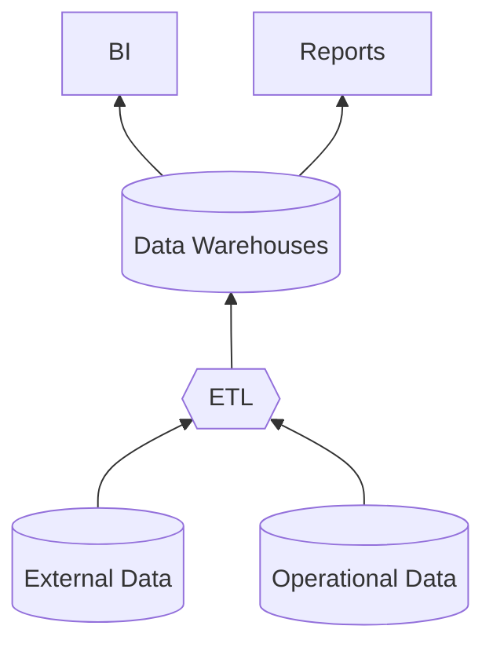
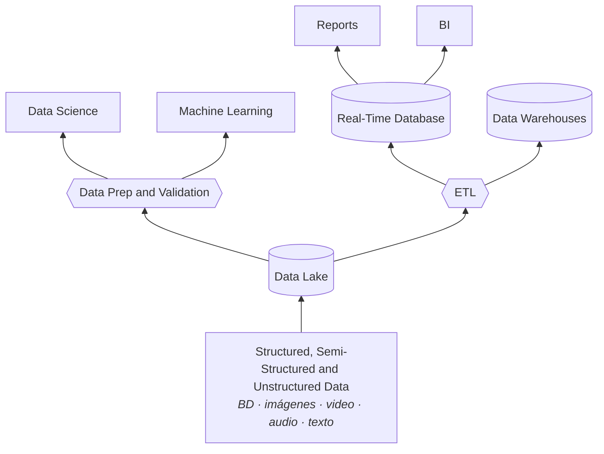
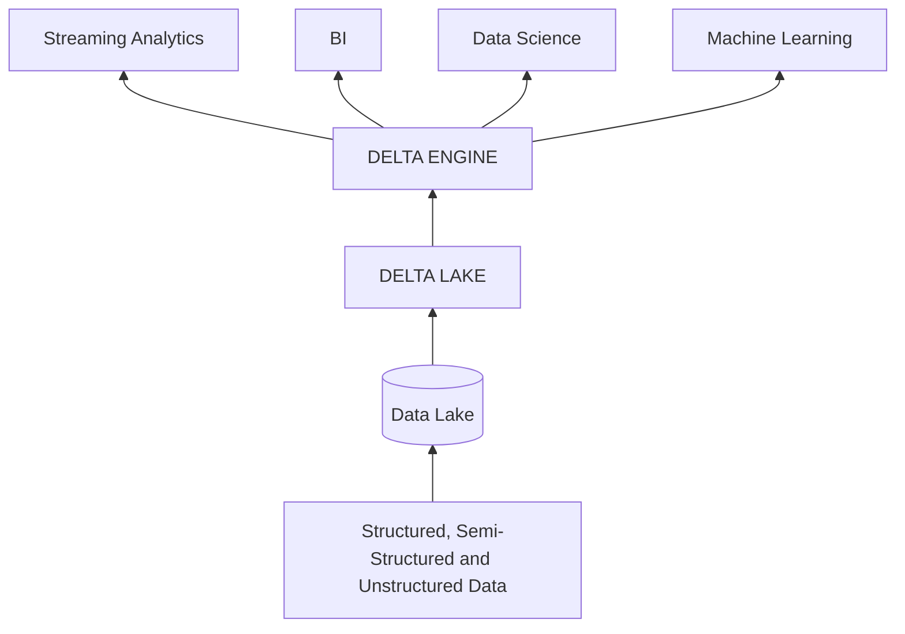
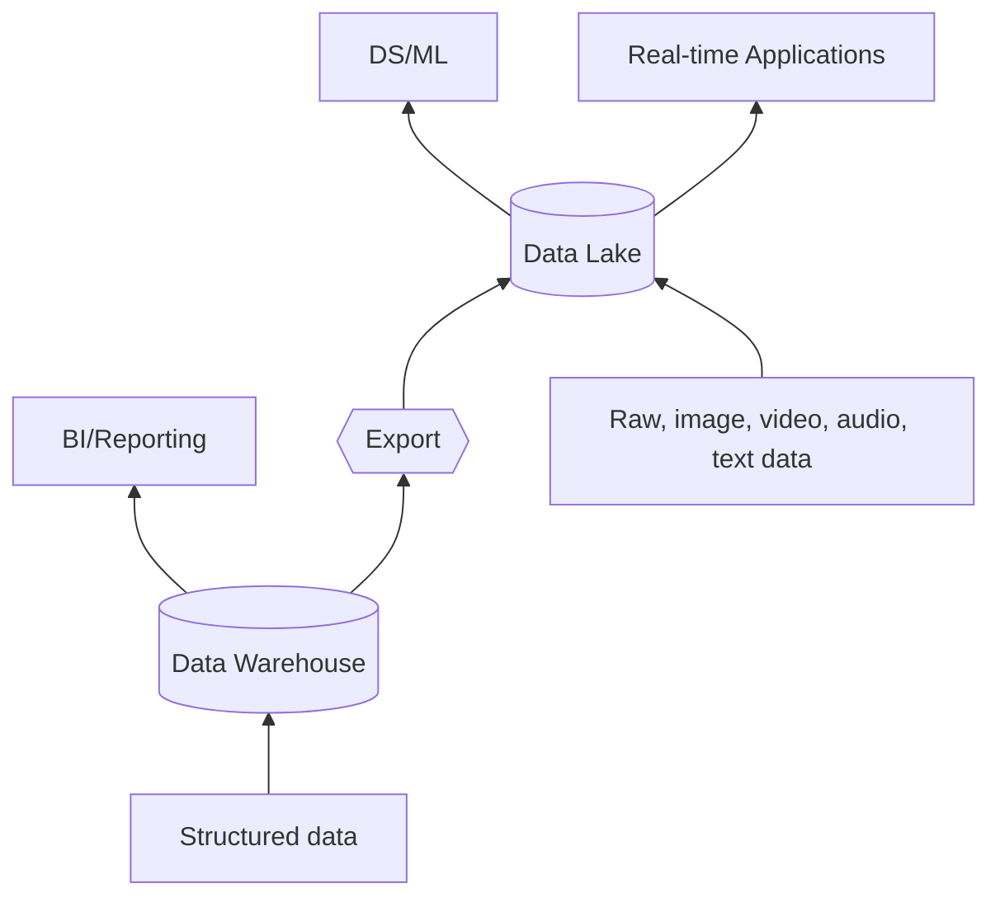
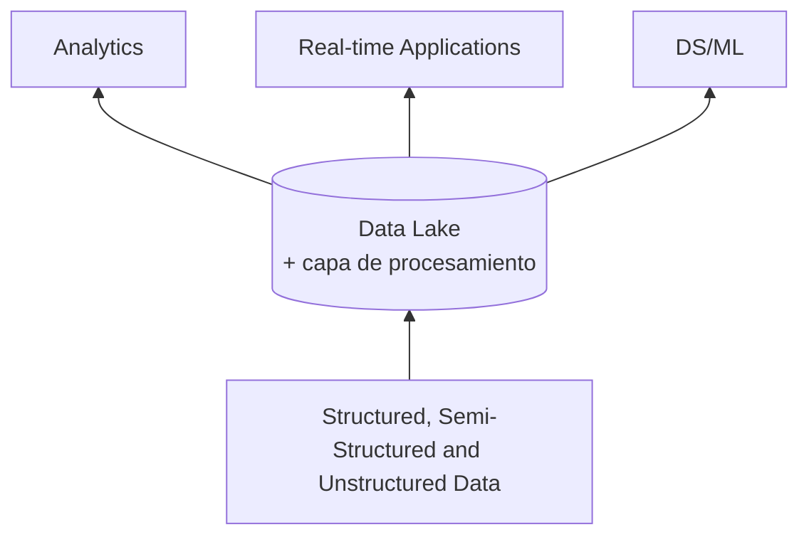
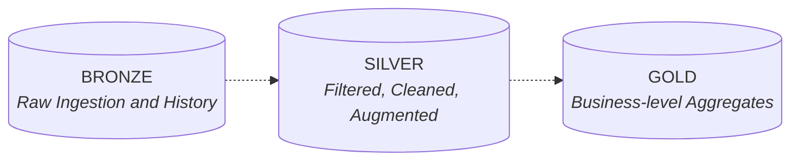
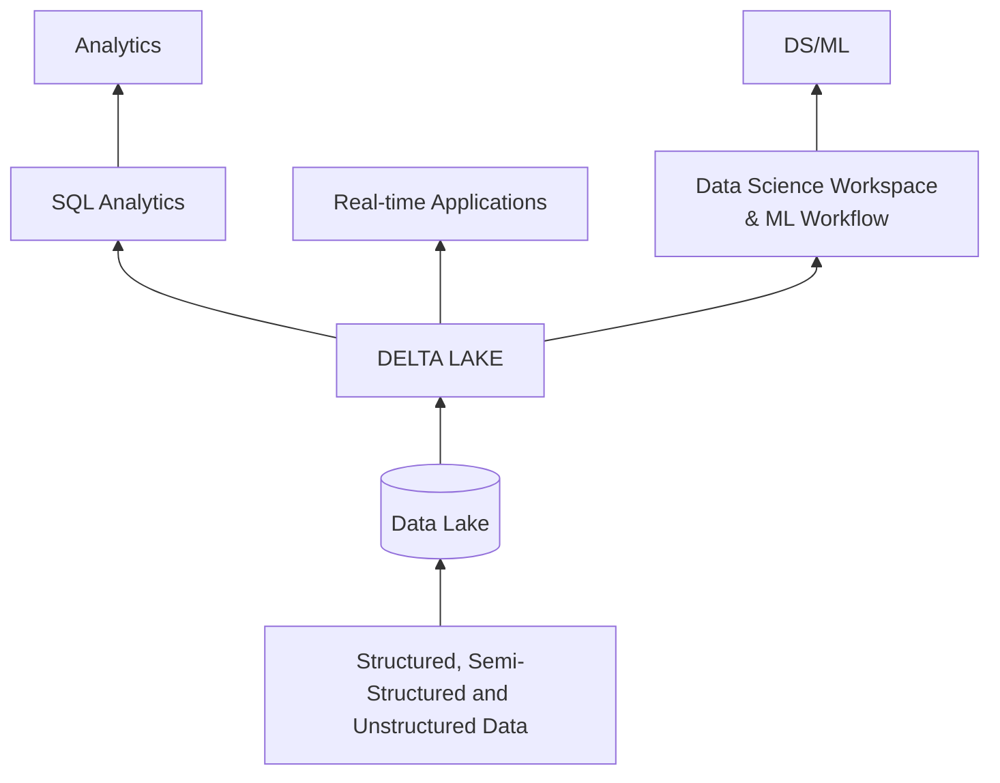

# SQL Analytics & Lake Architecture

## Data Warehouses

Fueron creados específicamente para BI y la presentación de informes. Sin embargo:

- No admite vídeo, audio ni texto.
- Sin soporte para ciencia de datos, ML.
- Soporte limitado para streaming.
- Formatos cerrados y propietarios.

Por lo tanto, la mayoría de los datos se almacenan en data lakes y blob storage.

## Data Lakes

Podría manejar todos sus datos para la ciencia de datos y ML, sin embargo…

- Escaso soporte BI.
- Complejo de configurar.
- Por rendimiento.
- Pantanos de datos poco fiables.

## La coexistencia no es una estrategia deseable

La diapositiva muestra ambos diagramas anteriores unidos con un **+**: mantener un Data Warehouse (para BI y reportes) **y** un Data Lake (para DS/ML) en paralelo, cada uno con sus propios ETL y copias de datos.

## Lakehouse

| Capa | Componente | Función |
|---|---|---|
| Superior | Streaming Analytics, BI, Data Science, Machine Learning | Una plataforma para cada caso |
| Motor | **Delta Engine** | Motor de consulta de alto rendimiento |
| Transaccional | **Delta Lake** | Estructura de la capa transaccional |
| Almacenamiento | Data Lake | Data lake para toda la data |

## La IA está trastornando sectores enteros

- Las principales empresas nacidas en la nube utilizan Data + AI para trastocar sectores enteros.

| Empresa | Uso de Data + AI |
|---|---|
| Uber | Predict price, supply & demand, carpools |
| Airbnb | Host preferences, price recommendation, custom LTV |
| Netflix | Content suggestions, streaming quality, thumbnail personalization |

## Datos en DW y exportación a data lake para la ciencia de datos

- Sistema cerrado y propietario.
- No se apoya la ciencia de datos.
- Costoso desde el punto de vista operativo y financiero.
- Aún se necesita un data lake para los datos no estructurados.

> La primera versión de esta diapositiva muestra solo los datos estructurados entrando al DW; la segunda agrega los datos no estructurados (raw, imagen, video, audio, texto) entrando directamente al data lake.

## Arquitectura Lakehouse

- Formato y arquitectura abiertos en el lago de datos.
- Soporte de primera clase para análisis, tiempo real, DS/ML.
- Excelente recencia de datos con una única fuente de verdad.

### Ecosistema alrededor del Lakehouse

El lakehouse queda rodeado (en un círculo) por las herramientas y proveedores con los que se integra:

- Data Warehouses
- BI Tools
- OLTP Tools
- ETL Tools
- Security Providers
- Data Providers

## Lakehouse: arreglando el problema con data lakes

### Desafíos de data lake

| # | Desafío | Tipo de problema |
|---|---|---|
| 1 | Hard to append data | Fiabilidad |
| 2 | Modification of existing data difficult | Fiabilidad |
| 3 | Jobs failing mid way | Fiabilidad |
| 4 | Real-time operations hard | Fiabilidad |
| 5 | Costly to keep historical data versions | Fiabilidad |
| 6 | Difficult to handle large metadata | Rendimiento |
| 7 | "Too many files" problems | Rendimiento |
| 8 | Poor performance | Rendimiento |
| 9 | Poor security | Gobernanza |
| 10 | Data quality issues | Calidad |

### Construyendo un Data Lake limpio

Arquitectura por capas (medallón):

## Lakehouse a través de Databricks

SQL Analytics se conecta con herramientas de BI existentes: Tableau, Qlik, Power BI, Spotfire, Looker, ThoughtSpot, Mode, MicroStrategy.

## Excelente relación calidad/precio

**30TB TPC-DS Price/Performance** (menor es mejor):

| Sistema | Costo |
|---|---|
| Cloud Data Warehouse 1 | $83 |
| Cloud Data Warehouse 2 | $273 |
| Cloud Data Warehouse 3 | $549 |
| **Databricks Lakehouse** | **$59** |

**SQL Compute: $0.15 / DBU** — Run SQL queries for BI reporting, analytics, and visualization to get timely insights from data lakes.

## SQL Analytics

El BI y los informes son ahora una experiencia de primera clase en los data lakes.

| Característica | Descripción |
|---|---|
| `SELECT… FROM… WHERE…` | SQL-native user interface for data analysts |
| Conectores | Built-in connectors for existing BI tools |
| Seguridad | Fine-grained governance |
| Rendimiento | Fast query performance |
