# Proyecto Lake

## El desafío del Almacenamiento de Datos

A medida que crecen el volumen y las "V" (velocidad, variedad, veracidad), cambia el tipo de almacenamiento necesario.

| Almacenamiento | Volumen | Fuentes típicas |
|---|---|---|
| **EDW/BW** | Gigabyte – Terabyte | Customers, Products |
| **Web 2.0** | Terabyte – Petabyte | Mobile, Marketing, eCommerce, Web Logs, Collaboration, Advertising |
| **Internet of Things** | Petabyte – Exabyte | Social Sites, Audio/Video, Sensors/Scanners, Log Files, Blogs/Wikis, GPS, Texts/Images |

Eje horizontal: **Velocity → Variety → Veracity**. Eje vertical: **Volume**.

## Flujo de un Data Lake por zonas

El Data Lake recibe *On-premises Data Movement* y *Real-time Data Movement*, y alimenta a *Machine Learning* y *Analytics*.

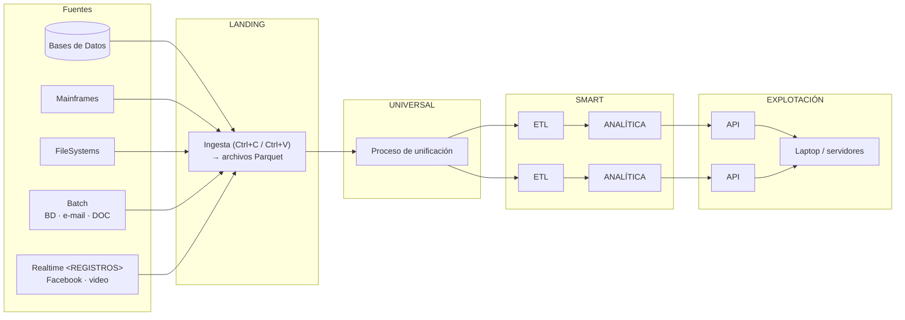

## Data Lake: Volumen

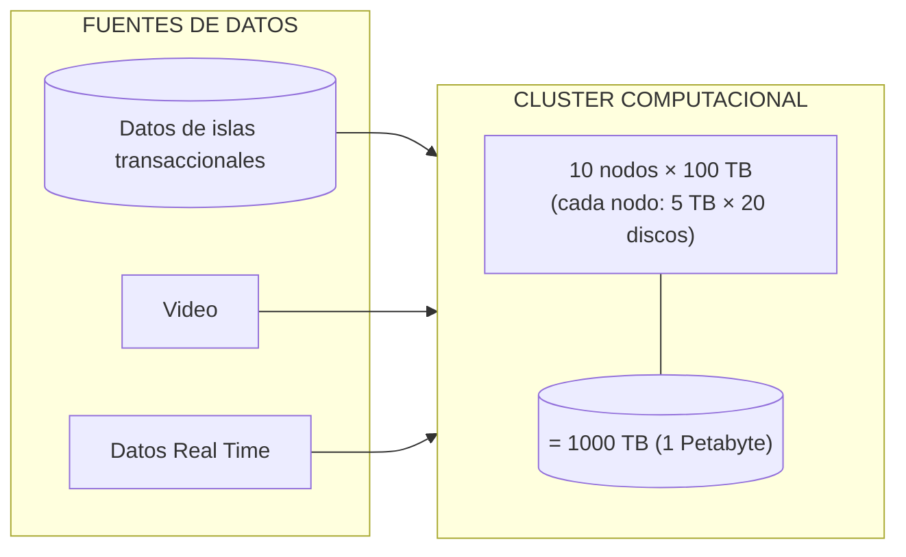

**¿Se quedó corto? → Agregar más nodos o discos** (escalamiento horizontal con Hadoop).

## Data Lake: Velocidad

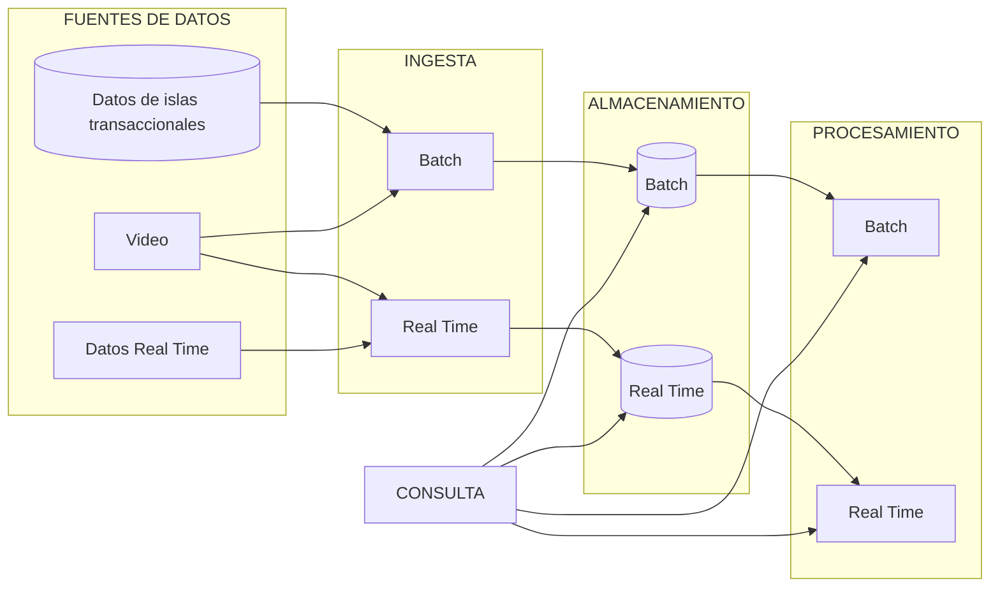

Cada etapa tiene su propia velocidad a considerar:

1. Velocidad de Ingesta
2. Velocidad de Almacenamiento
3. Velocidad de Procesamiento
4. Velocidad de Consulta

## Data Lake: Variedad

| Tipo de dato | Definición | Ejemplos |
|---|---|---|
| **Data estructurada** | Misma estructura para todos los registros | Tablas, CSV, XML |
| **Data semi-estructurada** | Cada registro tiene su propia estructura | JSON, XML |
| **Data no estructurada** | No tiene estructura ni registro | Videos, E-mail, Documentos, Lenguaje |

## Credicorp

Estructura del grupo (el proyecto se centra en **MiBanco**):

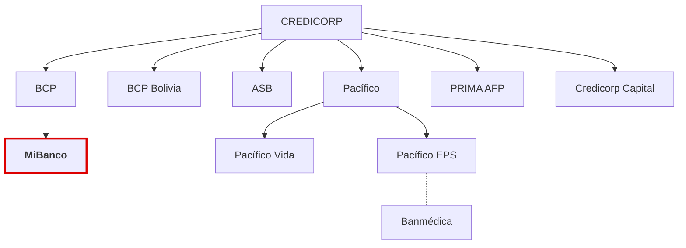

### Línea de tiempo

| Periodo | Etapa | Contenido |
|---|---|---|
| 2017 Q4 – 2018 Q2 | **Proyecto Credicorp Way** | Entendimiento de situación inicial · Adaptación al modelo objetivo · Roadmap de implementación de CU |
| Hito 2018 Q2 | | Casos de negocio · Arquitectura To-Be · Plan de implementación |
| 2019 Q1 – 2020 Q4 | **Proyecto DataLake** | Definición y despliegue de la arquitectura · Habilitación de modelo de datos holístico · Implementación de casos de uso |
| Hito 2020 Q4 | | Modelo Efectividad Comercial · Modelo Clientes Nuevos · Enciclopedia de Riesgos |
| 2021 → | **Evolución** | Soporte operacional · Adición de casos de uso |

### De la innovación a la estrategia del Data Lake

Ciclo **Innovation → Incubation → Commercialization**. La fase de *Innovation* (North Star Objectives / Explore & Hear Research) alimenta:

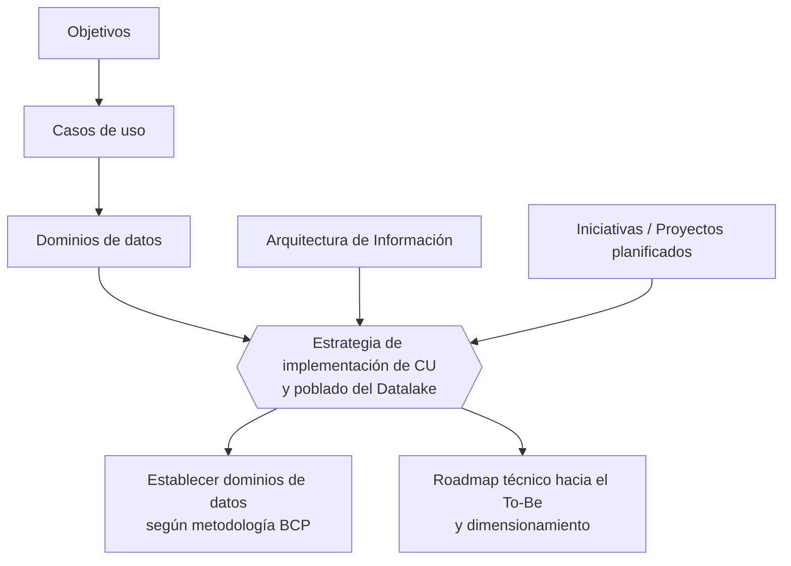

## Evaluación de la situación actual

Pregunta guía: **¿Qué áreas de negocio, procesos, sistemas y herramientas existen en MiBanco?**

Se crearon fichas por área (ejemplo en la diapositiva: *Riesgos – Riesgo de Créditos*, con descripción, funciones del área, orígenes de datos, métodos de carga, herramientas utilizadas, necesidades y problemas detectados) en base a la información recopilada, en donde se identifica:

- Funcionalidades principales del negocio
- Necesidades informacionales y problemas actuales
- Herramientas utilizadas (alto nivel)
- Procesos y sistemas utilizados
- Clasificación de usuarios

## Metodología del proyecto Credicorp

Las tres fases se coordinan bajo una **gestión de proyecto** común.

| | Entendimiento Situación Actual | Adaptación Modelo Objetivo | Roadmap de implementación |
|---|---|---|---|
| **Objetivos** | Entender la situación y necesidades informacionales del Negocio, así como los drivers del área de tecnología y la estrategia corporativa. | Definición de la Estrategia de Big Data para MiBanco, identificando los modelos y componentes necesarios para su integración con la arquitectura actual. | Plan de implementación de casos de negocio, según priorización definida, con la incorporación gradual y lógica de los componentes tecnológicos e informacionales necesarios. |
| **Actividades** | Entendimiento necesidades y problemas de las áreas funcionales · Entendimiento arquitectura funcional y tecnológica actual · Estrategia tecnológica · Estrategia corporativa | Identificación de casos de negocio · Identificación de dominio de datos en base al levantamiento de CN · Validación de la política corporativa de gestión de información de Credicorp · Identificación de componentes tecnológicos necesarios y adicionales | Identificación de complejidad, beneficio e impacto de los casos de negocio · Identificación de precondiciones y dependencias · Priorización conjunta de los casos de negocio · Plan de implementación |
| **Entregables** | As-Is Situación Actual | Casos de negocio · Dominio de datos · Arquitectura To-Be | Plan Implementación Arquitectura · Plan implementación de casos · Plan de Ingesta del Data Lake |

Artefactos de apoyo: Casos de Uso, Priorización de CU, Roadmap de Implementación.

## Arquitectura Referencial

*Framework everis Big Data & Analytics*

| Capa | Componentes |
|---|---|
| **Exploitation** | Uptake: Data Visualization, Data Discovery, Pull Queries, System Integration · Analytics: Text Mining, Data Mining, Machine Learning, Graph |
| **Processing** | Rule engine, Data masking, Data Enrichment, Complex Event Processing, Distributed Parallel Processing |
| **Storage** | Distributed, Relational, NoSQL, In-memory, Documental |
| **Intake** | Batch: File Gathering, Database Gathering, Internet Gathering · Streaming: Real-time Capture |
| **Sources** | Media, IoT, Social / News, Files, Backend DBs, Market Data (external), Docs, Cloud Services, Web Analytics |
| **Infrastructure** | Scalability, Performance, Availability, Reliability |

Transversal a todas las capas, **Data Governance**: Task Scheduling, Audit, Data Quality, Master Data Management, Meta Data Management, Security.

### Arquitectura tecnológica propuesta

| Capa | Componente | Tecnología |
|---|---|---|
| Analytic Applications | Visualization | Qlik, Microsoft Power BI |
| | Reporting | Qlik, Microsoft Power BI |
| | Data Blending | Cloudera Impala, RapidMiner |
| | Advanced Analytics & Modeling | Cloudera Data Science WorkBench: R, Python, Hive, Spark MLlib |
| Streaming / Real time | | Spark Streaming, Kafka |
| Data Lake | Dimensional Data | HBase, HDFS |
| | Experimental Data | HDFS |
| | Universal Data | HDFS, Hive |
| | Raw Data | HDFS, Hive |
| | EDW | |
| Batch Processing | | Apache Spark, IBM DataStage |
| Data Sources | | Oracle Database, Microsoft SQL Server, Flat files, Facebook |

Transversales: Metadata & Governance, Data Quality, Administration & Monitoring (Cloudera).

Artefactos de apoyo: Relación de Casos de Uso con componentes de Arquitectura; Fichas técnicas de implementación por cada Caso de Uso.

## Pasos posteriores al Assessment (evaluación)

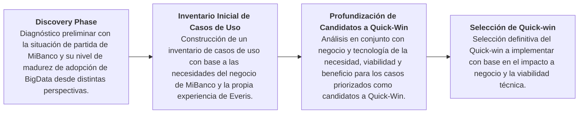

## Proyecto Data Lake MiBanco

- Despliegue de la Arquitectura.
- Modelo de Gestión Comercial.
- Lead de Clientes Nuevos.
- Enciclopedia de Variables.

### Ecosistema

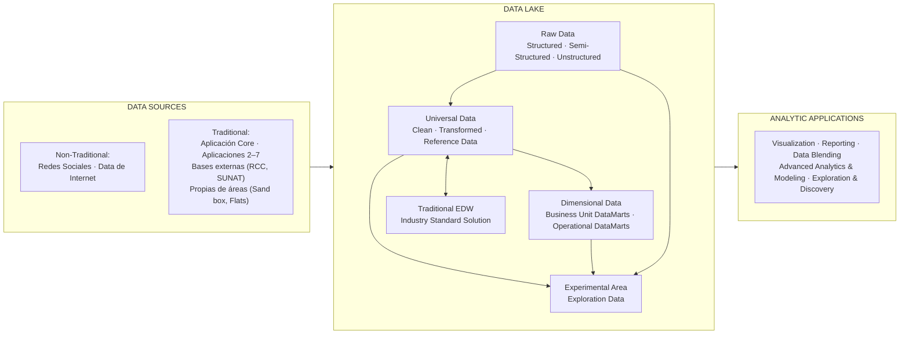

- **Streaming / Real-Time**: Event Processing, Data Transformation, Analytics.
- **Batch Processing**: Batch Ingestion, Data Transformation, Analytics.
- Transversales: Metadata Governance, Data Quality, Administration Monitoring.

### Rutas de Ejecución

Dos rutas de casos de negocio (C.N.) atraviesan el data lake:

- **C.N. Reporting** (verde): Data Sources → Raw Data → Universal Data → Dimensional Data (Business Unit / Operational DataMarts).
- **C.N. Analytics** (azul): Data Sources → Raw Data → Universal Data → Experimental Area (Exploration Data); también de Operational DataMarts hacia el Experimental Area.

| Zona | Características |
|---|---|
| **Raw Data** | Datos almacenados tal como se encuentran en las aplicaciones. Repositorio de los distintos tipos de datos en único lugar. El esquema de datos está definido por las … *(texto cortado en la diapositiva)* |
| **Universal Data** | Datos limpiados y modelados según los objetivos del negocio. Repositorio de información consistente. El esquema de datos es universal y definido por el negocio. |
| **Dimensional Data** | Datos dimensionales modelados según las necesidades de las unidades de negocio o según lo indiquen los motores (por ejemplo, Rentabilidad, Riesgo). Esquema de datos definido por los casos de … *(texto cortado en la diapositiva)* |
| **Experimental Area** | Almacén de datos con privilegios de escritura. Esquema de datos no definido. Usado solo para la explotación de información. |

### Modelo Unificado UDV

- Modelo Holístico
- Mejores Prácticas de referencia de modelos de industria
- Lineamientos Corporativos
- Atiende necesidades informacionales de los casos de negocio
- Diccionario de datos centralizado
- Modelado No-SQL
- Datos Gobernados (Linaje)

**Dominios de Datos:**

- Party & Locator
- Product
- Agreement
- Asset
- Campaign
- Event, Channel
- Financial

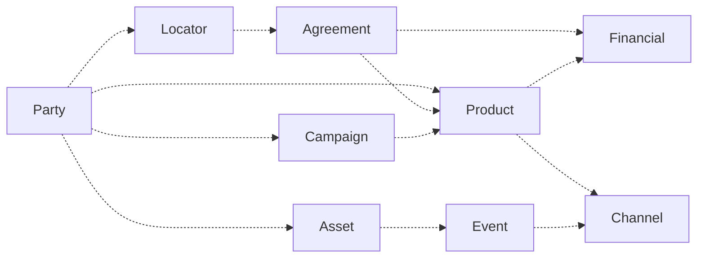

## CN1: Modelo Gestión Comercial

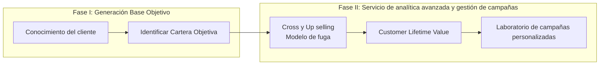

## CN2: Lead Clientes Nuevos

**Fuente de datos:** RCC SBS, Sunat, Sentinel ("¡Tu Reporte de Deudas completo!").

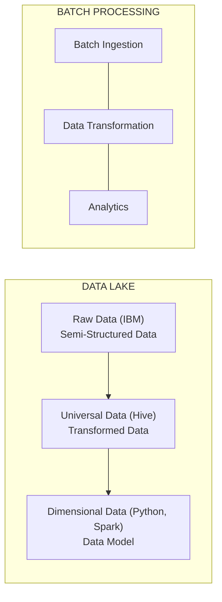

- Identificar Lead desde el reporte de empresas del sistema financiero.
- Información adicional que contribuye al análisis del lead:
  - **Sunat**: Actividad económica (CIIU), Fecha Alta RUC.
  - **Sentinel**: Ubicación Geográfica y Nivel Socio económico.

## CN3: Enciclopedia Variables

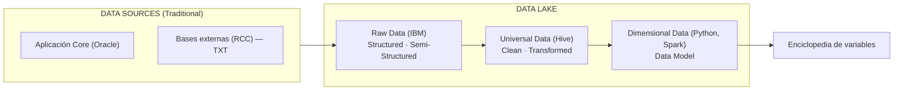

Proceso de construcción de variables:

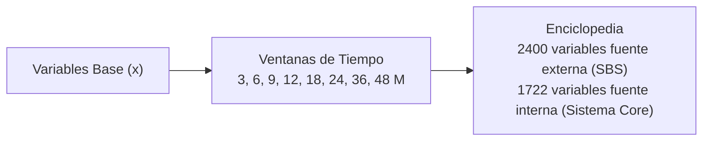

Ejemplos de variables: Consumos, Atrasos Días/Montos, Deuda Castigada, Meses deuda activa, Meses Calificación, Promedio Deudas, Meses Buen comportamiento.

## Team MiBanco

| Rol | Enfoque | Skills |
|---|---|---|
| **Team Leader** | Knowledge Leader | Analytical Skills · Business Domain & BigData Tools · Problem Solving Skills · Data Visualization & Programming Skills |
| **Product Owner** | Tactical member of the product development team | Business Knowledge · Responsible for defining Stories and prioritizing the Team Backlog · Communication Skills · Key person in any project and helps in delivering solutions |
| **Scrum Master** | Facilitator | Facilitate Meetings · Conflict Resolutions · Removing Impediments · Creating communication channel (team, Product owner, stakeholder) |
| **BigData Modeler** | Modeling + Industry Knowledge | SQL + NoSQL · Governance · Glosary · Metadata · Kimball · Modeling Tools · DAMA |
| **Data Engineer** | Data flows | Python · Scala/Java · Hive/Pig · Spark · HDFS · No-SQL · Streaming |
| **ML Architect** | ML Products Architectures | Python · Scala · No-SQL · Spark · DevOps · DataOps · Web Services · GPU, TPU · Dockers |
| **Big Data Architect** | Big Data Architectures | Python · Scala/Java · Hadoop Ecosystem · Spark · Flink · No-SQL · Lambda · Kappa · Cloud |

Metodología **Agile**.

| Ceremonias Scrum | Herramientas de Gestión |
|---|---|
| Daily sync | Jira |
| Review | Trello |
| Retrospectives | EasyBI |
| Planning | Microsoft Teams |

## Next Steps

- Modelo Soporte Data Lake
- Adición nuevas fuentes de datos:
  - Fuentes Internas:
    - Información aplicaciones Core
    - SandBox
    - Canales Digitales
  - Fuentes Externas:
    - RCA (Información Avales)
    - Padrón Electoral
    - Información entidades no reportadas
- Nuevos modelos analíticos
