# 09 RDD_v02.pdf

RDD Resilient Distributed Datasets: A Fault-Tolerant Abstraction for In-Memory Cluster Computing

RDD

• Los RDDs surgen debido a dos tipos de aplicaciones que los frameworks para computación en clúster que existían hasta ese entonces manejaban ineficientemente: algoritmos iterativos, que son comunes en aplicaciones de grafos y de minería de datos. En ambos casos, mantener los datos en la memoria mejoraría el rendimiento considerablemente. Para lograr la tolerancia a fallos de manera eficiente, los RDDs proporcionan una API basada en transformaciones coarse-grained que les permite recuperar datos de manera eficiente utilizando el lineage (linaje)

RDD Abstraction

• Un RDD es una colección de registros particionada de read-only . Los RDDs solo se pueden crear a través de operaciones deterministic en dataset en (1) almacenamientos estable u (2) otros RDDs • Llamamos a estas operaciones transformaciones para diferenciarlas de otras operaciones en RDDs. Ejemplos de transformaciones incluyen map , filter , groupBy , y join . • Los RDDs proporcionan una interfaz basada en transformaciones coarse- grained en vez de actualizaciones fine-grained al estado compartido. Esto es debido a que las transformaciones coarse-grained aplican la misma operación a muchos elementos de los datos, lo cual les permite proporcionar tolerancia a fallos de manera eficiente al registrar las transformaciones utilizadas para crear un dataset (es decir, su lineage ) en lugar de los datos reales.

RDD Abstraction

• Así, si se pierde una partición de un RDD, el RDD tiene suficiente información sobre cómo se derivó de otros RDDs para volver a calcular esa partición a partir de los datos en el almacenamiento estable. De esta manera, los datos perdidos se pueden recuperar, a menudo con bastante rapidez, sin requerir una replicación costosa. • En cambio, con una interfaz basada en actualizaciones fine-grained (como las que ofrecen las otras abstracciones existentes para el almacenamiento en memoria en clústeres), las únicas formas de proporcionar tolerancia a fallos son replicar los datos en las máquinas o registrar las actualizaciones en las máquinas, siendo ambas opciones costosas.

Spark Programming Interface

• Spark proporciona la abstracción RDD a través de una API de lenguaje integrado, donde cada dataset se representa como un objeto y las transformaciones se invocan utilizando métodos en estos objetos. • Los programadores comienzan definiendo uno o más RDDs a través de transformaciones en los datos en el almacenamiento estable. Luego pueden usar estos RDDs en acciones, las cuales son operaciones que devuelven un valor a la aplicación o exportan datos a un sistema de almacenamiento. • Los ejemplos de acciones incluyen count (que devuelve el número de elementos en el dataset), collect (que devuelve los elementos mismos) y save (que genera el dataset en un sistema de almacenamiento). Una transformación se evalúa de forma perezosa y el trabajo real ocurre cuando se produce una acción.

Spark Programming Interface

• Además, los programadores pueden llamar a un método de persistencia (persist) para indicar qué RDDs desean reutilizar en futuras operaciones. Spark mantiene los RDDs persistentes en memoria por default, pero puede ‘derramarlos’ en el disco si no hay suficiente RAM. Los usuarios también pueden solicitar otras estrategias de persistencia, como almacenar el RDD solo en el disco o replicarlo en las máquinas, a través de flags de persistencia. Finalmente, los usuarios pueden establecer una prioridad de persistencia en cada RDD para especificar qué datos en memoria deben ‘ derramarse ’ primero en el disco.

Example: Console Log Mining

• Supongamos que un servicio web está experimentando errores y se desea buscar terabytes de registros en el Hadoop file system (HDFS) para encontrar la causa. Usando Spark, podemos cargar solo los mensajes de error de los registros en la RAM a través de un conjunto de nodos y consultarlos de manera interactiva. Para esto se escribiría el siguiente código en Scala: 1. lines = spark.textFile ("hdfs : / / . . . ") 2. errors = lines.filter(_. starsWith ("ERROR") ) 3. errors.persist () 4. errors.count () • Script 1: Consultamos el número de mensajes de error en un archivo. La consulta retorna un número entero.

Example: Console Log Mining

• En la línea 1, se define el RDD lines a partir de la lectura de un archivo en el HDFS. Spark nos escucha y nos dice: “OK. Sí, lo haré”, pero en realidad aún no ha leído el archivo. En la línea 2, asumiendo que el contenido del archivo tiene líneas con mensajes de error que están marcados con la palabra “ERROR” al inicio, definimos el RDD errors a partir del filtrado de las líneas de error en el RDD lines. En la línea 3, se solicita a errors que persista en memoria, de modo que se pueda compartir entre consultas. Hasta este punto, no se ha realizado ningún trabajo en el clúster. Sin embargo, el usuario ahora puede usar el RDD errors en acciones, las cuales dejan como única opción a Spark realizar la operación especificada, como vemos en la línea 4 donde usamos la acción count para consultar el número de elementos que tiene errors, es decir, el número de mensajes de error en el archivo.

Example: Console Log Mining

• El usuario también puede realizar más transformaciones en el RDD y usar sus resultados: 1. errors.filter(_. contains ("MySQL") ).count() • Script 2: Consultamos el número de mensajes de error que mencionen “MySQL” en el archivo. La consulta retorna un número entero.

1. errors.filter(_.contains ("HDFS") 2. .map (_.split(‘ \ t ‘) (3) ) 3. .collect()

Example: Console Log Mining

• Script 3: Consultamos los campos de tiempo de los mensajes de error que mencionen “HDFS” (asumiendo que el tiempo es el campo número 3 y que los campos están separados por tabs) en el archivo. La consulta retorna un array. • Después de que la primera acción que involucra errors se ejecute, Spark almacenará las particiones de errors en memoria, acelerando en gran medida los cálculos posteriores en ella.

Example: Console Log Mining

• Grafo del lineage para los RDDs en el Script 3.

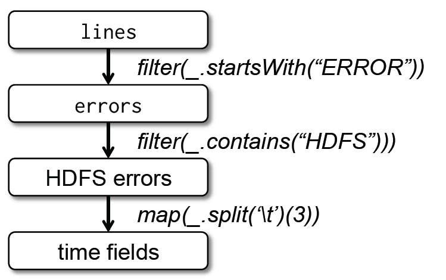

Spark Programming Interface

• Comparación entre los RDDs y la memoria compartida distribuida (DSM).

(*)

(**)

(***)

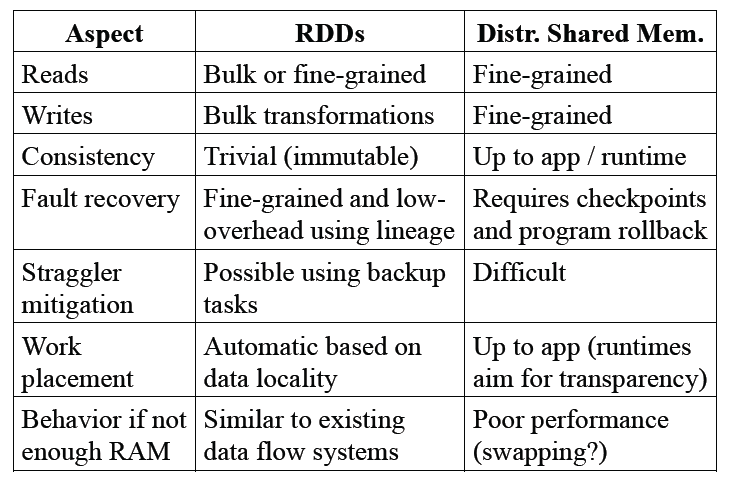

Spark Programming Interface

• De la Tabla podemos observar las ventajas que tienen los RDDs sobre DSM. Por ejemplo, (*) los RDDs son inmutables (una vez que hemos creado un RDD, éste no cambiará, sino que cada transformación que apliquemos sobre él generará un nuevo RDD) y pueden mitigar los nodos lentos implementando backups de las tareas lentas. Sin embargo, en los sistemas de DSM (**) esto sería difícil de implementar ya que las dos copias de una tarea accederían a las mismas ubicaciones de memoria e interferirían entre sí al momento de hacer las actualizaciones. Además, cuando no hay suficiente RAM, (***) las particiones de los RDDs que no caben en la RAM se pueden almacenar en el disco.

Applications Not Suitable for RDDs

• Los RDDs son los más adecuados para aplicaciones de lotes que aplican la misma operación a todos los elementos de un conjunto de datos. Por otro lado serían menos adecuados para las aplicaciones que realizan actualizaciones fine-grained asincrónicas al estado compartido.

Spark Programming Interface

• Para usar Spark, los desarrolladores escriben un programa driver que se conecta a un clúster de workers, como se muestra en la Figura

Conexión entre el driver y los workers

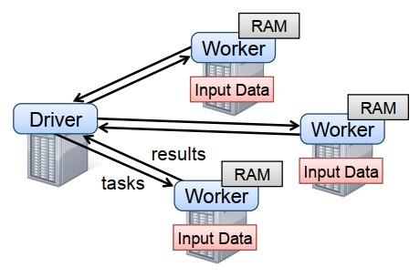

Spark Programming Interface

• El driver define uno o más RDDs e invoca acciones en ellos. El código Spark en el driver también rastrea el lineage de los RDDs. Los workers son procesos de larga duración que pueden almacenar particiones RDD en la RAM a través de las operaciones.

RDD Operations in Spark

Principales transformaciones y acciones. Seq[T] denota una secuencia de elementos de tipo T.

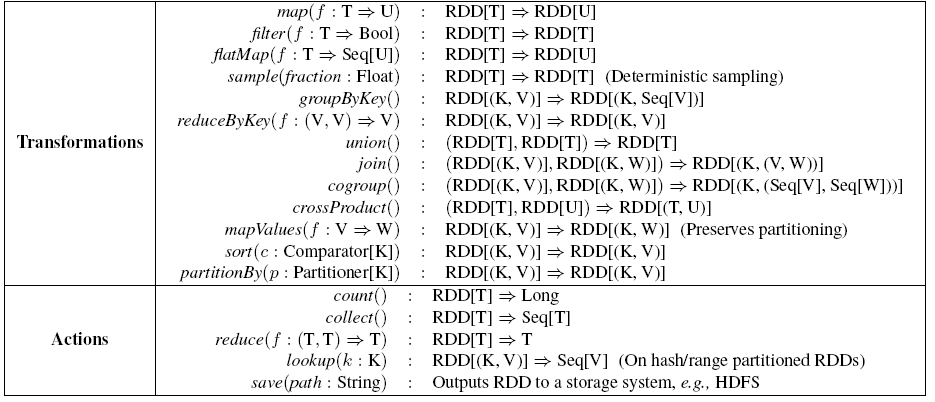

RDD Operations in Spark

En la Tabla anterior, muestra las principales transformaciones y acciones de los RDDs. Respecto a esta relación se debe tener en cuenta que: • Se muestran los tipos de parámetros entre corchetes. • Algunas operaciones, como join, solo están disponibles en RDDs de pares clave-valor. • map es un mapeo uno a uno, mientras que flatMap mapea cada valor de entrada a una o más salidas (similar al map en MapReduce ). • Además de estas operaciones, los usuarios pueden obtener el orden de partición de un RDD, el cual está representado por una clase Partitioner , y particionar otro dataset de acuerdo a este. • Las operaciones como groupByKey , reduceByKey y sort automáticamente dan como resultado un RDD hashpartioned o rangepartitioned .

Example Applications

• A continuación, mostraremos dos aplicaciones iterativas: regresión logística y PageRank. Regresión logística • Es un algoritmo de clasificación común que busca un hiperplano w que mejor separe dos conjuntos de puntos (por ejemplo, correos spam y no spam). El algoritmo utiliza descenso de gradiente: al inicio w tiene un valor aleatorio, y en cada iteración, se suma una función de w sobre los datos para mover w en una dirección que lo mejora.

Example Applications

• Implementación del algoritmo de descenso de gradiente. 1 val points = spark.textFile(...) 2 .map(parsePoint).persist() 3 var w = // incializar con valor aleatorio 4 for ( i <− 1 to ITERATIONS)

{ 5 val gradient = points.map{ p => 6 p.x ∗ (1/(1+exp(− p.y ∗ (w dot p. x)))−1) ∗ p.y 7 }.reduce((a,b) => a+b) 8 w −= gradient 9 }

Example Applications

• En el Script 4, definimos un RDD persistente llamado points como resultado de una transformación map en un archivo de texto que analiza cada línea de texto para obtener la data. Luego, inicializamos w con un valor aleatorio. Finalmente, ejecutamos iterativamente las operaciones map y reduce sobre points para calcular el gradiente en cada paso al sumar una función del w actual.

Example Applications

• The MapReduce model can readily be expressed using RDDs. Given an input dataset with elements of type T and functions myMap : T=> List[(Ki, Vi)] and myReduce : (Ki, List[Vi]) )=> List[R], one can write:

1. data.flatMap(myMap) 2. .groupByKey() 3. .map((k, vs) => myReduce(k, vs)) • The reduceByKey operation performs partial aggregations on the mapper nodes, like MapReduce’s combiners.

Example Applications

PageRank • Un patrón más complejo de intercambio de datos ocurre en PageRank. El algoritmo actualiza iterativamente un rango (rank) para cada documento al sumar las contribuciones de los documentos que lo vinculan (vecinos). En cada iteración, cada documento envía una contribución de ri/ni a sus vecinos (links), donde: • ri es el rank del i-ésimo documento. • ni es el número de vecinos del i-ésimo documento.

Example Applications

1. val vertices = // RDD of (ID, State) pairs 2. val messages = // RDD of (ID, Message) pairs 3. val grouped = vertices.cogroup(messages) 4. val newData = grouped.mapValues

{ 5. (vert, msgs) => userFunc(vert, msgs) // returns (newState, outgoingMsgs) 6. }

.cache() 7. val newVerts = newData.mapValues((v,ms) => v) 8. val newMsgs = newData.flatMap((id,(v,ms)) => ms)

Example Applications

• Alternatively, if the job has a combiner, one can write:

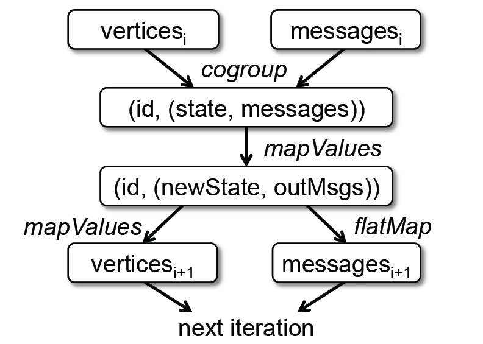

RDD Representation

• Resumimos la interfaz utilizada para representar a los RDDs en Spark en

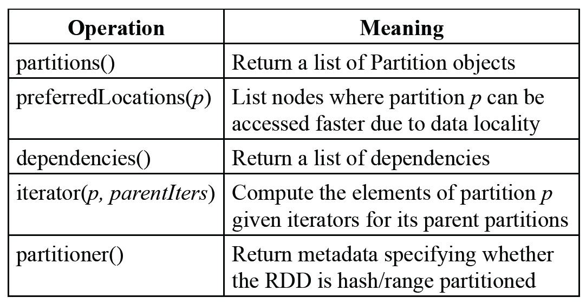

RDD Representation

Clasificamos las dependencias entre RDDs en dos tipos: • Narrow Dependencies . Cada partición del RDD padre es utilizada como máximo por una partición del RDD hijo. • Wide Dependencies . Varias particiones hijo pueden depender de la partición del RDD padre.

RDD Representation

Examples of narrow and wide dependencies. Each box is an RDD, with partitions shown as shaded rectangles.

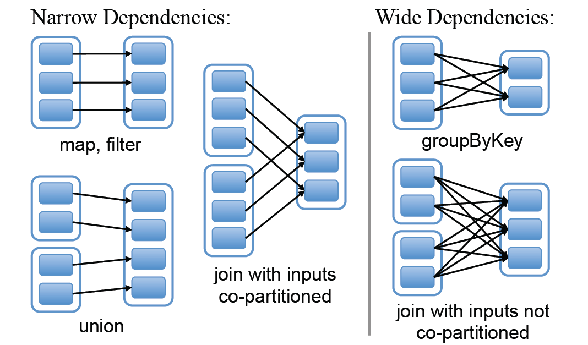

RDD Representation

A continuación, mostramos algunas implementaciones de RDD: • HDFS files : Los RDDs de entrada en nuestros ejemplos han sido archivos en HDFS. Para estos RDDs: partitions devuelve una partición para cada bloque del archivo, preferredLocations proporciona los nodos en los que está el bloque e iterator lee el bloque. • map : Devuelve un objeto MappedRDD. Este objeto tiene las mismas particiones y ubicaciones preferidas que su padre, pero aplica la función que se pasa a map, a los registros del padre en su método iterator. • union : Devuelve un RDD cuyas particiones son la unión de las de los padres. Cada partición hijo se calcula a través de una dependencia narrow del padre correspondiente.

Implementation

Planificador de trabajos • El planificador tiene en cuenta qué particiones de RDDs persistentes están disponibles en memoria. Cuando un usuario ejecuta una acción en un RDD, el planificador examina el grafo de lineage de ese RDD para construir un grafo acíclico dirigido (DAG) de etapas a ejecutar

Implementation

Ejemplo de cómo Spark calcula las job stages . Los rectángulos con contornos sólidos son RDDs. Las particiones son rectángulos sombreados en negro si ya están en cache . Para ejecutar una acción en el RDD G, construimos etapas de construcción en las dependencias wide pipelines de y en las transformaciones narrow dentro de cada etapa. En este caso, el stage 1 no necesita ejecutar ya que B esta en cache, entonces ejecutamos 2 y 3.

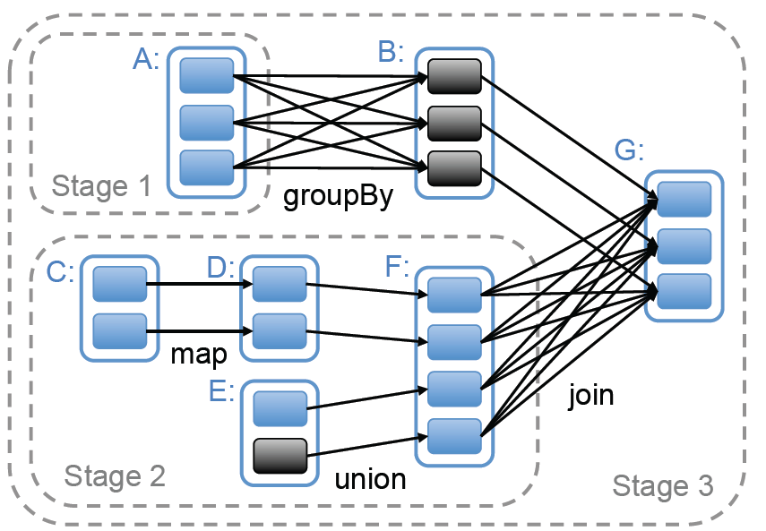

Cache Management

Spark ofrece tres opciones para el almacenamiento de RDDs persistentes: • Almacenamiento en memoria como objetos Java deserializados. Proporciona el rendimiento más rápido, ya que la JVM puede acceder a cada elemento RDD de forma nativa. • Almacenamiento en memoria como datos serializados. • Almacenamiento en disco. Es útil para los RDDs que son demasiado grandes para mantenerlos en la RAM pero costosos para volver a calcularlos en cada uso.

Cache Management

• Para administrar la memoria limitada disponible, se usa una política de desalojo de LRU (Least Recently Used) a nivel de RDDs. Cuando se calcula una nueva partición RDD pero no hay suficiente espacio para almacenarla, desalojamos una partición del RDD que ha permanecido por más tiempo sin ser accesado, a menos que este sea el mismo RDD que el de la nueva partición. En ese caso, mantenemos la antigua partición en la memoria.

Soporte para Checkpointing

• El checkpointing es útil para los RDDs con grafos de lineage largos que contienen dependencias wide, como los datasets ranks utilizados en PageRank. En estos casos, una falla de nodo en el clúster puede ocasionar la pérdida de cierta porción de datos de cada RDD padre, lo que requiere una re-cálculo completo. • Por el contrario, para los RDDs con dependencias narrow en los datos en el almacenamiento estable, como los points en nuestro ejemplo de regresión logística y las listas de links en el PageRank, el checkpointing no es necesario ya que si un nodo falla, las particiones perdidas de estos RDDs pueden volver a calcularse en paralelo en otros nodos, a una fracción del costo de replicar todo el RDD.

Evaluación

• Evaluamos Spark y los RDDs a través de una serie de experimentos en Amazon Elastic Compute Cloud (Amazon EC2). A menos que se indique lo contrario, las pruebas utilizaron nodos EC2 de tipo m1.xlarge con 4 núcleos y 15 GB de RAM, y HDFS para almacenamiento con bloques de 256 MB.

Behavior with Insufficient RAM

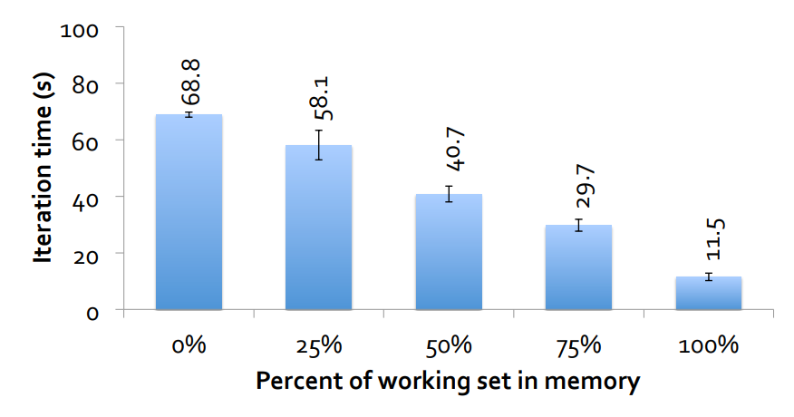

Scalability

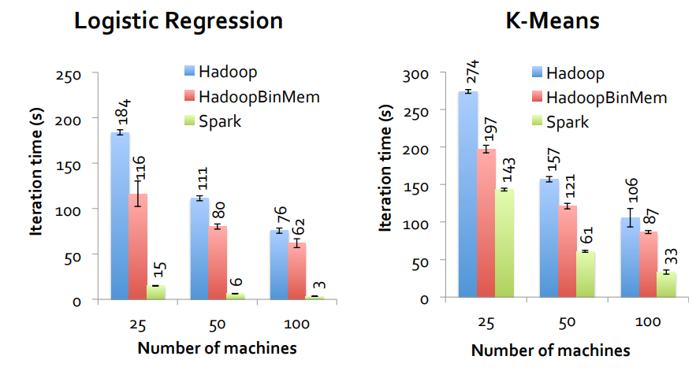

Breaking Down the Speedup

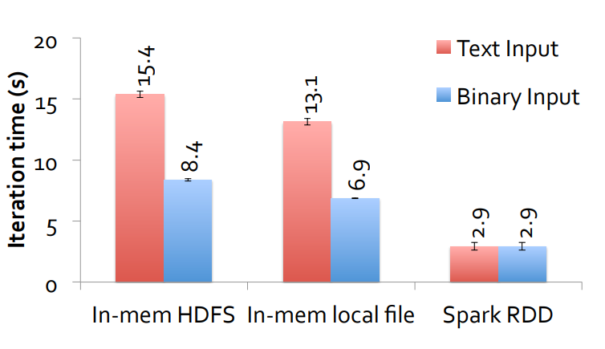

Spark Operations

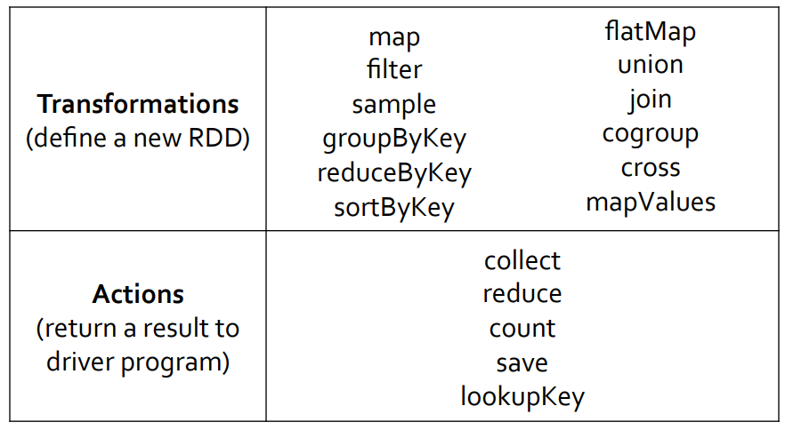
