# 09 SparkMapReduce_es.pdf

Spark MapReduce

Motivación de Spark

• MapReduce simplificó enormemente el análisis de big data en clústeres grandes y poco fiables. Es excelente para el cálculo de una sola pasada. • Pero en cuanto se hizo popular, los usuarios querían más: • Análisis más complejos y de varias pasadas (por ejemplo, ML, gráficos). • Consultas ad hoc más interactivas • Más procesamiento de flujos en tiempo real • Los tres necesitan un intercambio de datos más rápido entre trabajos paralelos. • Una reacción: modelos especializados para algunas de estas aplicaciones, por ejemplo: • Pregel (procesamiento de grafos) • Storm (procesamiento de flujos)

Limitaciones de MapReduce

Ventajas del flujo de datos: el tiempo de ejecución puede decidir dónde ejecutar las tareas y recuperarse automáticamente de los fallos.

Como modelo de programación general: • Es más adecuado para el cálculo de una sola pasada en un gran conjunto de datos • Es difícil componer y anidar operaciones múltiples • No permite expresar operaciones iterativas Como se implementa en Hadoop • Todos los conjuntos de datos se leen del disco y se vuelven a almacenar en él. • Todos los datos se replican (normalmente) tres veces para mayor fiabilidad. • No es fácil escribir programas MapReduce en Java.

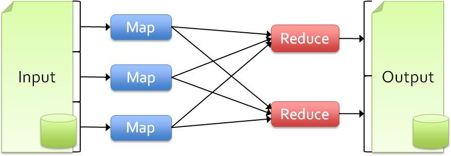

Compartimiento de data en MapReduce

Lento debido a: replication, serialization, and disk IO • Las aplicaciones complejas, el streaming y las consultas interactivas necesitan una cosa de la que MapReduce carece : Primitivas eficaces para compartir datos

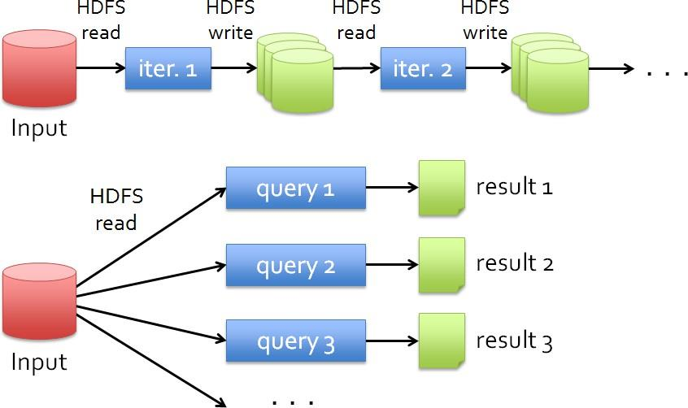

Compartición de data en MapReduce

• Los trabajos iterativos implican mucha E/S de disco para cada repetición

• Las consultas interactivas y el procesamiento en línea implican mucha E/S de disco

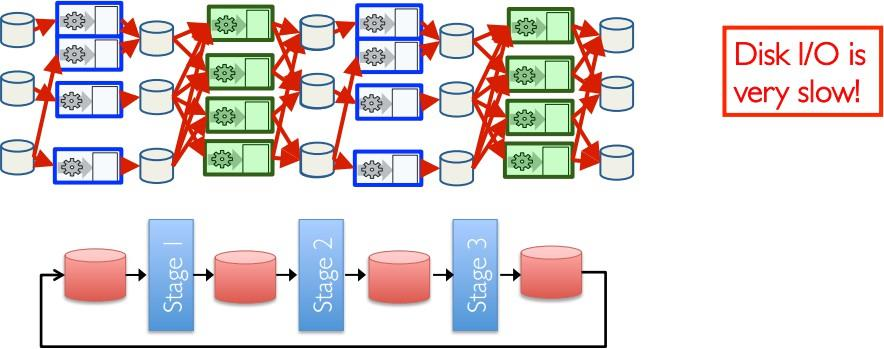

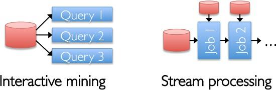

Ejemplo: PageRank

• Multiplicación repetida de matrices y vectores dispersos • Requiere unir repetidamente listas de adyacencia de páginas y vector de rango

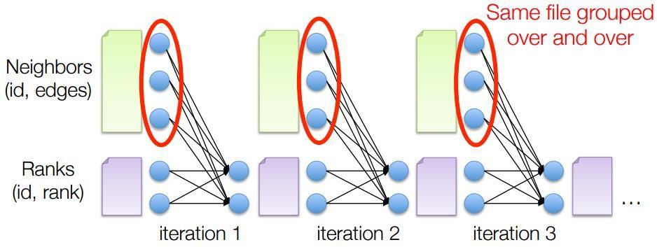

Hardware para Big Data

Muchos discos duros Muchos CPUs

Y un montón de memory!

Objetivos de Spark

• Mantener más datos en memoria para mejorar el rendimiento • Ampliar el modelo MapReduce para que admita mejor dos clases comunes de aplicaciones analíticas: • Algoritmos iterativos (aprendizaje automático, gráficos) • Minería de datos interactiva • Mejora de la programabilidad: • Integración en el lenguaje de programación ScalaPermitir el uso interactivo desde el intérprete Scala

Compartición de datos en Spark usando RDD

× 10-100 rápido que red y disco

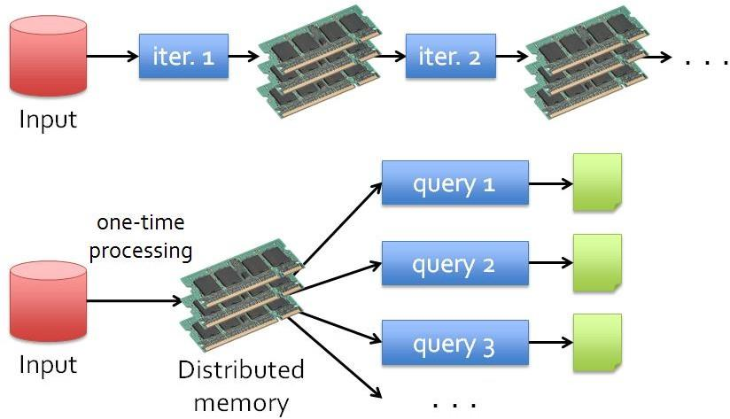

Que es Spark

Una respuesta popular a: “¿Qué hay más allá de MapReduce?” Motor de procesamiento de datos a gran escala de código abierto • Soporta flujos de datos generalizados • Escrito en Scala , con enlaces en Java y Python Historia breve: • Desarrollado en AMPLab de la Universidad de Berkeley en 2009 • Liberado como código abierto en 2010 • Se convirtió en un proyecto de alto nivel de Apache en febrero de 2014 • Soporte comercial proporcionado por Databricks

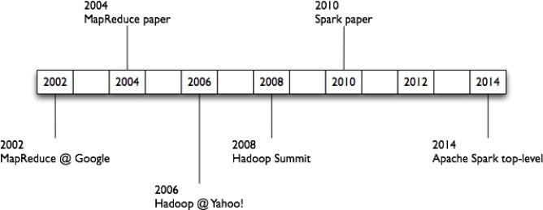

Que es Spark

• Sistema de cálculo en clúster rápido y expresivo interoperable con Apache Hadoop. Mejora la eficiencia mediante: × Up to 100 faster • Primitivas de computación en memoria × (2-10 on disk) • Gráficos de cálculo generales Mejora la usabilidad mediante • API enriquecidas en Scala, Java y × Python Often 5 less code • Shell interactivo •

### Spark no es

• Una versión modificada de Hadoop • Dependiente de Hadoop debido a que tiene su propio sistema • Solo usa Hadoop con fines de almacenamiento

Que es Spark

• Spark es la base de un amplio conjunto de proyectos del Berkeley Data Analytics Stack (BDAS)

Spark MLlib Shark GraphX Streaming (machine (SQL) (graph) learning) (real-time)

## …

Spark

• Spark Streaming (procesamiento de flujos) • GraphX (procesamiento de gráficos) • MLlib (biblioteca de aprendizaje automático) • Spark SQL (SQL en Spark)

Fuentes de datos

• Archivos locales • file:///opt/httpd/logs/access_log • S3 • Hadoop Distributed Filesystem • Ficheros regulares, ficheros de secuencia, cualquier otro InputFormat de Hadoop • HBase, Cassandra, etc.

Spark Ideas

• Sistema informático expresivo, no limitado al modelo map- reduce • Facilitar la memoria del sistema a evitar guardar resultados intermedios en disco para almacenar datos en caché para consultas repetitivas (por ejemplo, para aprendizaje automático) • Superponer un sistema en memoria a Hadoop. • Lograr la tolerancia a fallos mediante la reejecución en lugar de la replicación

Componentes de Spark • Un programa Spark crea primero un objeto SparkContext • Indica a Spark cómo y dónde acceder a un clúster • Conectarse a varios tipos de gestores de clúster (por ejemplo, YARN o su propio gestor) • Cluster manager: • Asignación de recursos entre aplicaciones • Spark executor: • Corre aplicaciones • Acede a la data almacenada

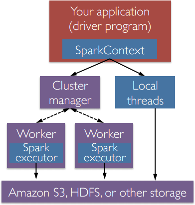

Desafio

• Sistemas Existentes • Los actuales sistemas de almacenamiento en memoria tienen interfaces basadas en actualizaciones "finas". • Lee y escribe celdas en la tabla • E.g., bases de datos, almacenes clave-valor, memoria distribuida • Requiere replicar datos o registros entre nodos para la tolerancia a fallos.- > expensive! • 10-100x más lenta que la escritura en memoria • ¿Cómo diseñar una abstracción de memoria distribuida que sea a la vez tolerante a fallos y eficiente?

Solución: Conjuntos de datos distribuidos

resilientes

• Datasets Distribuidos Resilientes (RDDs) • Colecciones distribuidas de objetos que pueden almacenarse en memoria caché en todo el clúster • Manipuladas mediante operadores paralelos • Recálculo automático en caso de fallo basado en el linaje • Los RDDs pueden expresar muchos algoritmos paralelos, y capturar muchos modelos de programación actuales • Data flow models: MapReduce, SQL, … • Specialized models for iterative apps: Pregel, …

Que esRDD

• Conjuntos de datos distribuidos resistentes : Una abstracción tolerante a fallos para la computación en clúster en memoria. • RDD es una abstracción de memoria distribuida que permite a los programadores realizar cálculos en memoria en grandes clústeres de forma tolerante a fallos. •

### Resiliente

• Tolerante a fallos, es capaz de re computar particiones perdidas o dañadas debido a fallos de nodos. •

### Distribuido

• Datos que residen en varios nodos de un clúster. •

### Dataset

• Una colección de elementos particionados, por ejemplo tuplas u otros objetos (que representan registros de los datos con los que se trabaja). • RDD es la principal abstracción de datos en Apache Spark y el núcleo de Spark. Permite realizar operaciones sobre una colección de elementos en paralelo

Características de RDD

• In-Memory , es decir, los datos dentro del RDD se almacenan en memoria tanto (tamaño) y tanto (tiempo) como sea posible. • Immutable or Read-Only , es decir, no cambia una vez creado y sólo puede ser transformado usando transformaciones a nuevos RDDs. • Lazy evaluated , es decir, los datos dentro del RDD no están disponibles o transformados hasta que se ejecuta una acción que desencadena la ejecución. • Cacheable , es decir, se pueden guardar todos los datos en un "almacenamiento" persistente como memoria (por defecto y el más preferido) o disco (el menos preferido debido a la velocidad de acceso). • Parallel , es decir, procesa los datos en paralelo. • Typed , es decir, los valores en un RDD tienen tipos, por ejemplo RDD[Long] o RDD[(Int, String)]. • Partitioned , es decir, los datos dentro de un RDD son particionados (divididos en particiones) y luegodistribuidos a través de nodos en un cluster (una partición por JVM que puede o nocorresponder a un único nodo).

RDD Operaciones

• Transformation: Retorna una nueva RDD. • Nada se evalúa cuando se llama a una función de Transformación, sólo toma un RDD y devuelve un nuevo RDD. • Incluye map, filter, flatMap, groupByKey, reduceByKey, aggregateByKey, filter, join, etc. • Action: Evalúa y retorna un nuevo valor. • Cuando se llama a una función Action sobre un objeto RDD, todas las consultas de procesamiento de datos se calculan en ese momento y se devuelve el valor del resultado. • Incluyen reduce, collect, count, first, take, countByKey, foreach, saveAsTextFile, etc.

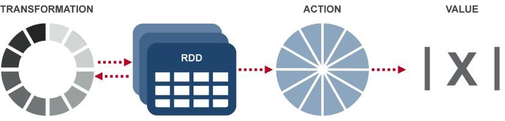

Trabajando con RDDs

• Crear un RDD a partir de una fuente de datos. • paralelizando las colecciones (listas) existentes en Python. • Transformando RDDs existentes. • Desde archivos en HDFS u otros almacenes • Aplicando transformaciones a un RDD: e.g., map, filter • Aplicando acciones a un RDD: e.g., collect, count

• Los usuarios pueden controlar otros aspectos como: • Persistencia • Particionado de datos

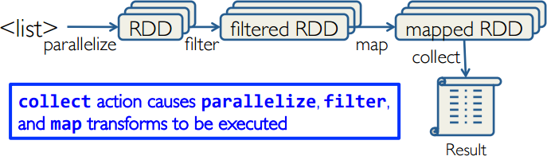

Creando RDDs

• Desde HDFS, text files, Amazon S3, Apache HBase, SequenceFiles, o algún otro formato de entrada de Hadoop. • Creando un RDD desde un archivo • val inputfile = sc.textFile("...", 4) • RDD distribuido en 4 particiones • Los elementos son líneas de entrada • Evaluación perezosa significa que ahora no hay ejecuciónparalelizando colecciones (listas) existentes en Python

• Convertir una colección Python en un RDD. • sc.parallelize([1, 2, 3]), creating from a Python list • Creación de un RDD a partir de un InputFormat de Hadoop existente. • sc.hadoopFile(keyClass, valClass, inputFmt, conf)

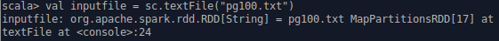

Transformaciones en Spark

• Crear un nuevo dataset a partir de uno existente. • Uso de la evaluación perezosa: los resultados no se calculan de inmediato, sino que Spark recuerda el conjunto de transformaciones aplicadas al conjunto de datos base. • Spark optimiza los cálculos necesarios • Spark se recupera de fallos. • Algunas funciones

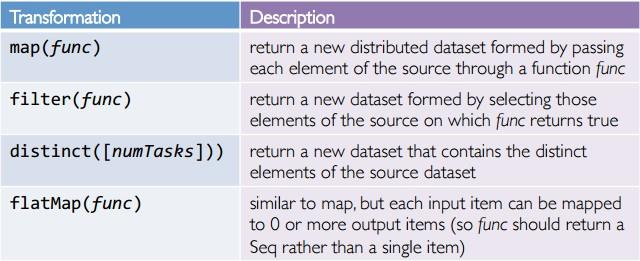

Acciones en Spark

• Hacer que Spark ejecute la transformación para transformar la fuente • Mecanismo para obtener resultados de Spark • Algunas funciones de acción

• ejemplo: words.collect().foreach(println)

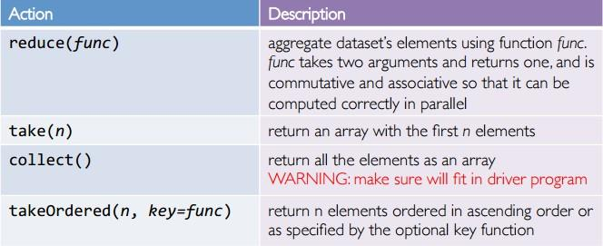

Ejemplo

• Un servicio web está experimentando errores y los operadores quieren buscar la causa en terabytes de registros en el sistema de archivos Hadoop. //base RDD val lines = sc.textFile(“hdfs://…”) //Transformed RDD val errors = lines.filter(_.startsWith(“Error”)) errors.persist() errors.count() errors.filter(_.contains(“HDFS”)) .map(_split(‘\t’)(3)) .collect()

• Line1: RDD backed by an HDFS file (base RDD lines not loaded in memory) • Line3: Asks for errors to persist in memory (errors are in RAM)

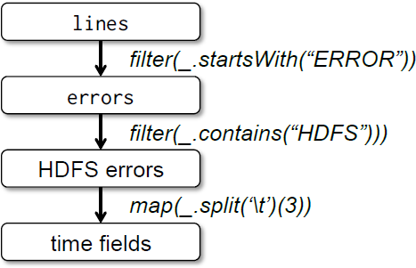

Gráfico de linaje

Los RDD llevan la cuenta del linaje • El RDD tiene suficiente información sobre su origen para calcular sus • particiones a partir de datos almacenados de forma estable..

### RDD1

### RDD2

### RDD3

### RDD4

• ejemplo: • Si se pierde una partición de errores, Spark la reconstruye aplicando un filtro sólo sobre la partición de líneas correspondiente. • Las particiones pueden volver a calcularse en paralelo en distintos nodos, sin necesidad de deshacer todo el programa..

De construir

//base RDD val lines = sc.textFile(“hdfs://…”) //Transformed RDD val errors = lines.filter(_.startsWith(“Error”)) errors.persist() errors.count() errors.filter(_.contains(“HDFS”)) .map(_.split(‘\t’)(3)) .collect()

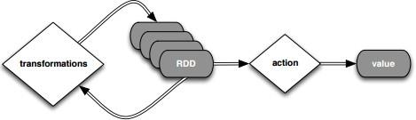

De construido

//base RDD val lines = sc.textFile(“hdfs://…”)

//Transformed RDD val errors = lines.filter(_.startsWith(“Error”)) errors.persist()

errors.count()

count() causes Spark to: 1) lea data; 2) suma dentro de las particiones; 3) Combina sumas en el Put transform and action together: driver errors.filter(_.contains(“HDFS”)).map(_split(‘\t’)(3)).collect()

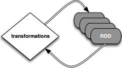

SparkContext

• SparkContext es el punto de entrada a Spark para una aplicación Spark. • Una vez que SparkContext es creado tu puedes usar para • Crear RDDs • Crear acumuladores • Crear variables de broadcast • Acceder a Spark services y correr jobs • Un contexto Spark es esencialmente un cliente del entorno de ejecución de Spark y actúa como el maestro de su aplicación Spark es el punto de entrada a Spark para una aplicación Spark • Lo primero que debe hacer un programa Spark es crear un objeto SparkContext, que indica a Spark cómo acceder a un cluster • En el shell de Spark, ya se ha creado un SparkContext especial para el intérprete, en la variable llamada sc

RDD Persistence: Cache/Persist

• Una de las capacidades más importantes de Spark es la persistencia (o almacenamiento en caché) de un conjunto de datos en memoria a lo largo de las operaciones. • Cuando persiste un RDD, cada nodo almacena cualquier partición del mismo. Puede reutilizarlo en otras acciones sobre ese conjunto de datos} • Cada RDD persistente puede almacenarse utilizando un nivel de almacenamiento diferente, por ejemplo: • MEMORY_ONLY: • Almacenar RDD como objetos Java deserializados en la JVM. • Si el RDD no cabe en memoria, algunas particiones no se almacenarán en caché y se volverán a calcular cuando se necesiten. • Este es el nivel por defecto. • MEMORY_AND_DISK: • Si el RDD no cabe en memoria, almacena las particiones que no caben en disco, y léelas desde allí cuando se necesiten. • cache() = persist(StorageLevel.MEMORY_ONLY)

Por qué persistir RDD?

val lines = sc.textFile(“hdfs://…”) valerrors= lines.filter(_.startsWith(“Error”)) errors.persist() errors.count() • Si vuelves a hacer errors.count(), el archivo se cargará de nuevo y se computará de nuevo. • Persist le dirá a Spark que almacene en caché los datos en memoria, para reducir el coste de carga de datos para acciones posteriores sobre los mismos datos • erros.persist() no hará nada. Es una operación perezosa. Pero ahora el RDD dice "leer este archivo y luego almacenar en caché el contenido". La acción desencadenará el cálculo y el almacenamiento en caché de los datos

Spark Key-Value RDDs

• Al igual que Map Reduce, Spark admite pares Clave- Valor • Cada elemento de un RDD de pares es una tupla de pares • Algunas funciones de transformación Clave-Valor :

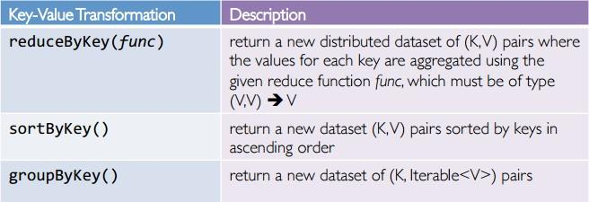

Scala

Scala (Scalable language)

• Scala es un lenguaje de programación de propósito general diseñado para expresar patrones de programación comunes de una manera concisa, elegante y segura • Scala soporta tanto Programación Orientada a Objetos como Programación Funcional • Scala es Práctico • Puede ser usado como reemplazo de Java • Mixed Scala/Java projects • Usa librerías Java existentes • Usa herramientas Java existentes(Ant, Maven, JUnit, etc…) • Soporte IDE Decente(NetBeans, IntelliJ, Eclipse)

Porque Scala?

• Scala es un lenguaje orientado a objetos puro. Conceptualmente, cada valor es un objeto y cada operación es una llamada a un método. El lenguaje soporta arquitecturas de componentes avanzadas a través de clases y rasgos. • Scala es también un lenguaje funcional. Soporta funciones, estructuras de datos inmutables y preferencia por la inmutabilidad frente a la mutación • Se integra perfectamente con Java • e utiliza mucho para Big data, por ejemplo, Spark, Akka, etc.

Scala Sintaxis básica

• Al considerar un programa Scala, se puede definir como una colección de objetos que se comunican a través de la invocación de los métodos de los demás. • Object − igual a Java • Class − igual a Java • Methods − igual Java • Fields − Cada objeto tiene su conjunto único de variables instantáneas, que se llaman campos. • Traits − Como en Java Interface. Un trait encapsula definiciones de métodos y campos. • Closure − Una clausura es una función, cuyo valor de retorno depende del valor de una o más variables declaradas fuera de esta función.closure = function + enviroment. closure = function + enviroment

Scala está tipado estáticamente

• No se define generalmente el tipo val sum = 1 + 2 + 3 val nums = List(1, 2, 3) val map = Map("abc" -> List(1,2,3))

• Explicitamente val sum : Int = 1 + 2 + 3 val nums : List[Int] = List(1, 2, 3) val map : Map[String, List[Int]] = ...

Scala es de alto nivel

// Java – Check if string has uppercase character boolean hasUpperCase = false ; for (int i = 0; i <name .length(); i++)

{ if (Character.isUpperCase( name .charAt(i))) { hasUpperCase = true ; break ; } }

// Scala val hasUpperCase = name .exists(_.isUpperCase)

Scala es consiso

### // Scala

class Person( var name: String, private var _age: Int)

{ // Java def age = _age // Getter for age def age_= (newAge:Int) { // Setter for age println("Changing age to: "+newAge) publicclass Person{ _age = newAge private Stringname; } private intage; } public Person(String name,Intage){ this.name=name; this.age=age; } public StringgetName() { //namegetter returnname; } public intgetAge() { //agegetter returnage; } public voidsetName(String name){ //namesetter this.name=name; } public voidsetAge(int age){ //agesetter this.age=age; } }

Variables y Values

• Variables: values stored can be changed var foo = "foo" foo = "bar" // okay

• Values: immutable variable val foo = "foo" foo = "bar" // nope

Scala es orientado a objetos

// Every value is an object 1.toString // Every operation is a method call → 1 + 2 + 3 (1).+(2).+(3) // Can omit . and ( ) → "abc" charAt 1 "abc".charAt(1) // Classes (and abstract classes) like Java abstract class Language( val name:String)

{ override def toString = name }

// Example implementations class Scala extends Language("Scala") // Anonymous class val scala = new Language("Scala")

{ /* empty */ }

Scala Traits

// Like interfaces in Java trait JVM

{ // But allow implementation override def toString = super.toString+" runs on JVM" }

trait Static

{ override def toString = super.toString+" is Static" }

// Traits are stackable class Scala extends Language with JVM with Static

{ val name = "Scala" }

→ println( new Scala) "Scala runs on JVM is Static"

Scala es funcional

• Funciones de primera clase. Las funciones se tratan como objetos : • pasar funciones como argumentos a otras funciones} • devolver funciones como valores de otras funciones • asignar funciones a variables o almacenarlas en estructuras de datos // Lightweight anonymous functions

### (x:Int) => x + 1

// Calling the anonymous function val plusOne = (x:Int) => x + 1 → plusOne(5) 6

Scala es funcional

• Cierres: una función cuyo valor de retorno depende del valor de una o más variables declaradas fuera de esta función. // plusFoo can reference any val ues/ var iables in scope var foo = 1 val plusFoo = (x:Int) => x + foo

→ plusFoo(5) 6

// Changing foo changes the return value of plusFoo foo = 5 → plusFoo(5) 10

Scala es Funcional

• Funciones de orden superior • Una función que hace al menos una de las siguientes cosas: • toma una o más funciones como argumentos • devuelve una función como resultado val plusOne = (x:Int) => x + 1 val nums = List(1,2,3) // map takes a function: Int => T → nums.map ( plusOne ) List(2,3,4) // Inline Anonymous → nums.map ( x => x + 1 ) List(2,3,4) // Short form → nums.map ( _ + 1 ) List(2,3,4)

El uso de “_” en Scala

• En las funciones anónimas, el signo «_» sirve de marcador de posición para los parámetros • nums.map ( x => x + 1 ) is equivalent to: nums.map ( _ + 1 )

List(1,2,3,4,5).foreach(print(_)) is equivalent to: List(1,2,3,4,5).foreach( a => print(a) )

• Puede utilizar dos o más guiones bajos para referirse a diferentes parámetros. val sum = List(1,2,3,4,5).reduceLeft(_+_) is equivalent to: val sum = List(1,2,3,4,5).reduceLeft((a, b) => a + b) • El método reduceLeft funciona aplicando la función/operación que le indiques, y aplicándola a los elementos sucesivos de la colección

Spark Programming Model

Cómo funciona Spark

• Las aplicaciones de usuario crean RDD, los transforman y ejecutan acciones. • El resultado es un DAG (grafo acíclico dirigido) de operadores. • El DAG se compila en etapas • Each stage is executed as a series of Task (one Task for each Partition).

Word Count in Spark

val file = sc.textFile(“hdfs://…”, 4) RDD[String]

textFile

Word Count in Spark

val file = sc.textFile(“hdfs://…”, 4) RDD[String] val words = file.flatMap(line => RDD[List[String]] line.split(“\t”))

flatMap textFile

Word Count in Spark

val file = sc.textFile(“hdfs://…”, 4) RDD[String] val words = file.flatMap(line => RDD[List[String]] line.split(“\t”)) val pairs = words.map(t => (t, 1)) RDD[(String, Int)]

map flatMap textFil e

Word Count in Spark

val file = sc.textFile(“hdfs://…”) RDD[String] val words = file.flatMap(line => RDD[List[String]] line.split(“\t”)) val pairs = words.map(t => (t, 1)) RDD[(String, Int)] val count = pairs. reduceByKey(_+_) RDD[(String, Int)]

reduceByKey map flatMap textFil e

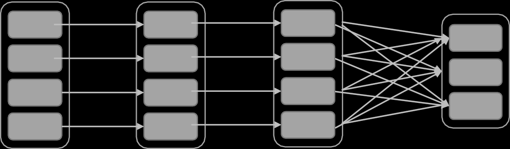

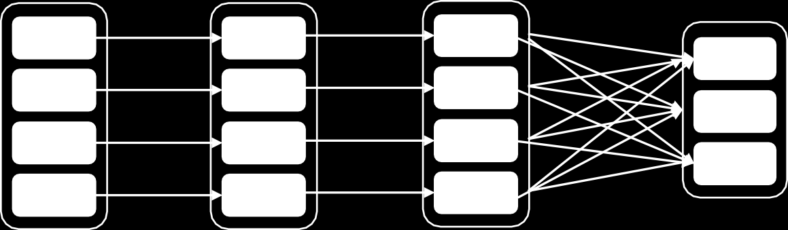

Word Count in Spark

val file = sc.textFile(“hdfs://…”, 4) RDD[String] val words = file.flatMap(line => RDD[List[String]] line.split(“\t”)) val pairs = words.map(t => (t, 1)) RDD[(String, Int)] val count = pairs. reduceByKey(_+_) RDD[(String, Int)] count.collect() Array[(String, Int)]

collect reduceByKey map flatMap textFil e

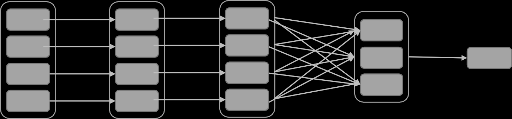

Plan de ejecución

### Stage 1

### Stage 2

collect reduceByKey map flatMap textFile

• El planificador examina el grafo lineal del RDD para construir un camino de etapas. • Las etapas son secuencias de RDDs, que no tienen un Shuffle entre ellas. • Los límites son las etapas shuffle.

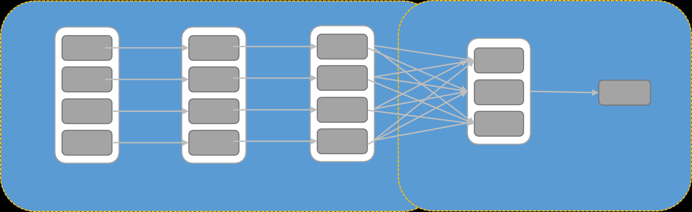

Ejecución por Task1 etapas Task2 Task2 Task2

• Crear una tarea para cada Partición en el nuevo RDD • Serializar la Tarea • Programar y enviar las Tareas a los Esclavos • Todo esto ocurre internamente

Word Count in Spark (Vista detallada)

• Word Count using Scala in Spark

Transformation

Action “to” (to,1) (be,2) “be” (be, 1) “to be or” (not,1) “or” (or,1) “not” (not,1) (or,1) “to” (to,1) “not to be” (to,2) “be” (be, 1)

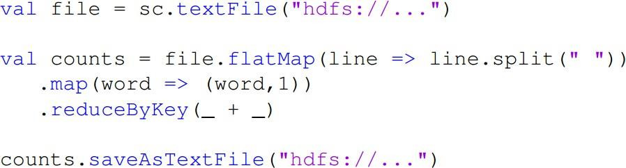

RDD Operations

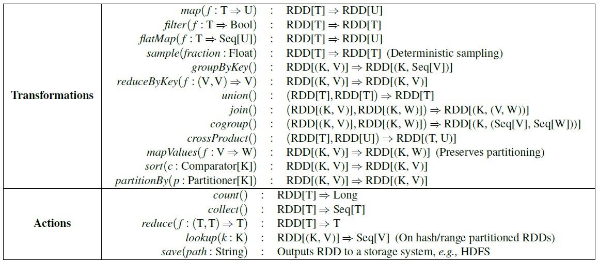

Más ejemplos

• Crear una RDD a partir de RDDs existentes val pairs = sc.parallelize( List( (“This”, 2), (“is”, 3), (“Spark”, 5), (“is”, 3) ) ) pairs.collect().foreach(println) Output? • reduceByKey() function: reduce key-value pairs by key using give func val pair1 = pairs.reduceByKey((x,y) => x + y) pair1.collect().foreach(println) Output? • mapValues() function: work on values only

val pair2 = pairs.mapValues( x => x -1 ) pair2.collect().foreach(println) Output? • groupByKey() function: When called on a dataset of (K, V) pairs, returns a dataset of (K, Iterable<V>) pairs pairs.groupByKey().collect().foreach(println)

Establecer el nivel de paralelismo

• Todas las operaciones RDD de pares toman un segundo parámetro opcional para el número de tareas > words.reduceByKey((x,y) => x + y, 5) > words.groupByKey(5)

Aplicación autónoma (Scala)

• No es una forma interactiva

import org.apache.spark.SparkContext import org.apache.spark.SparkContext._ import org.apache.spark.SparkConf object WordCount

{ def main(args: Array[String]) { val inputFile = args(0) val outputFolder = args(1) val conf = new SparkConf().setAppName (“wordCount”). setMaster (“local”) // Create a Scala Spark Context. val sc = new SparkContext(conf) // Load our input data. val input = sc.textFile(inputFile) // Split up into words. val words = input.flatMap(line => line.split(" ")) // Transform into word and count. val counts = words.map(word => (word, 1)).reduceByKey(_+_) counts.saveAsTextFile(outputFolder) } }

• Primero tienes que crear un objeto SparkContext

Spark Web Console

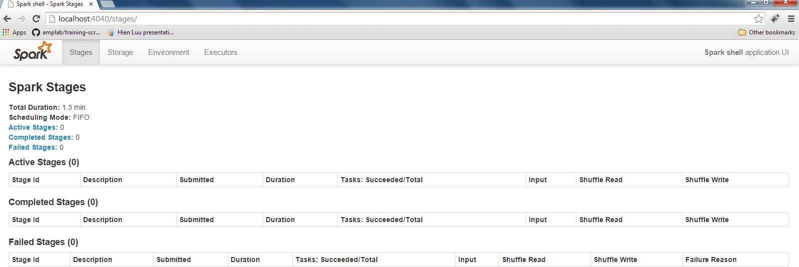

Spark Applications

• Minería de datos en memoria sobre datos Hive (Conviva) • Análisis predictivo (Quantifind) • Predicción del tráfico urbano (Mobile Millennium) • Clasificación del spam en Twitter (Monarch) • Filtrado colaborativo mediante factorización matricial …

Spark and Map Reduce Differences

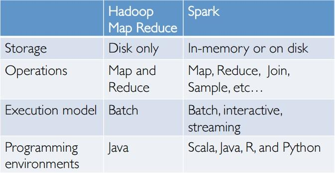
