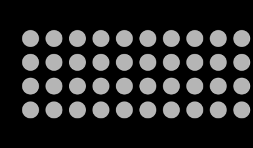
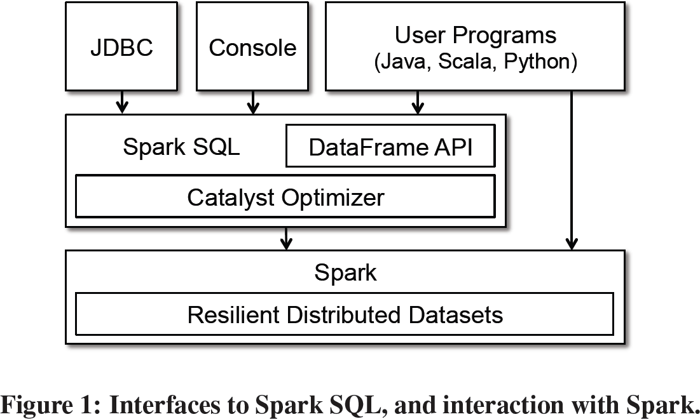
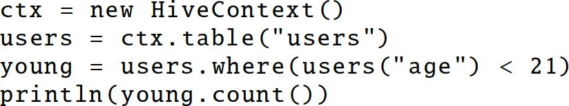
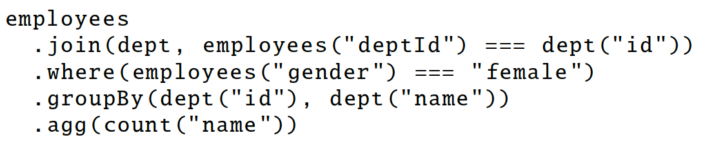
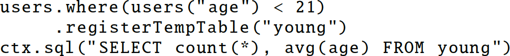
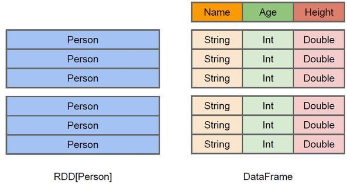
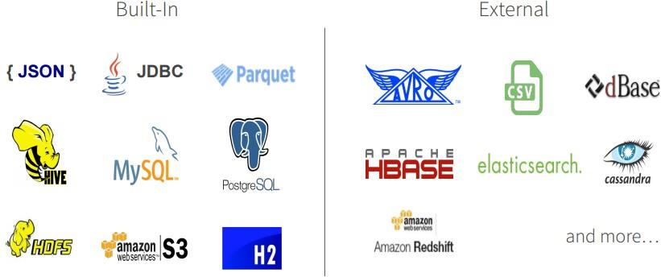
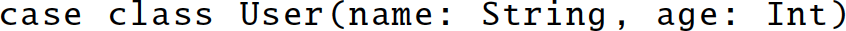

# 09 SparkSqlDataframees.pdf

Spark SQL


Desafíos y Soluciones

### Desafíos Soluciones

• • Realizar ETL hacia y desde Una API de DataFrame que puede varias fuentes de datos realizar operaciones relacionales (semiestructurados o no tanto en fuentes de datos estructurados) externas como en los RDD integrados de Spark. • Realizar análisis avanzados • Un optimizador altamente (por ejemplo, aprendizaje extensible, Catalyst , que utiliza automático, procesamiento de características de Scala para gráficos) que son difíciles de agregar reglas componibles, expresar en sistemas controlar la generación de código relacionales. y definir extensiones.. 2


Que es Apache Spark?

• Sistema de computación en clúster rápido y general, interoperable con Hadoop, incluido en todas las distribuciones principales

• Mejora la eficiencia mediante: Up to 100 × faster Primitivas de computación en memoria (2-10 × on disk) Gráficos de computación general • Mejora la usabilidad mediante: 2-5 × less code API avanzadas en Scala, Java y PythonShell interactivo


Modelo Spark

• Escribir programas en términos de transformaciones en conjuntos de datos distribuidos • Resilient Distributed Datasets (RDDs) • Colecciones de objetos que pueden almacenarse en memoria o disco en un clúster. • Transformaciones funcionales paralelas (mapa, filtro, etc.). • Reconstrucción automática en caso de fallo.


On-Disk Sort Record: Time to sort 100TB

2013 Record: 2100 machines Hadoop 72 minutes

207 machines 2014 Record: Spark 23 minutes Also sorted 1PB in 4 hours 5 Source:DaytonaGraySortbenchmark, sortbenchmark.org





Powerful Stack – Agile Development

140000 Your fancy 120000 SIGMOD technique here 100000 80000 60000 GraphX 40000 SparkSQL Streaming 20000 0 Hadoop Storm Impala (SQL) Giraph (Graph) Spark MapReduce (Streaming) non-test, non-example source lines


Acerca de

## SQL

• Spark SQL • Parte de la distribución principal desde Spark 1.0 (abril de 2014) #OfCommitsPer Month #of Contributors 250 200 200 150 150 100 100 11 50 50 0 0


## SQL

Acerca de

• Spark SQL • Parte de la distribución principal desde Spark 1.0 (abril de 2014) • Ejecuta consultas SQL/HiveQL, opcionalmente junto con implementaciones de Hive existentes o reemplazándolas.

SELECT COUNT(*) FROM hiveTable 12 WHERE hive_udf(data)


Mejora del arte existente

• • El motor no comprende la Solo se puede usar para consultar estructura de los datos en RDD datos externos en el catálogo de ni la semántica de las funciones Hive -> fuentes de datos limitadas del usuario, lo que limita la • Solo se puede invocar mediante una optimización. cadena SQL desde Spark -> propenso a errores • Optimizador de Hive adaptado a MapReduce -> difícil de ampliar

13


Interfaz de programación

14




DataFrame

• Una colección distribuida de filas con el mismo esquema (los RDD sufren de borrado de tipos). • Puede construirse a partir de fuentes de datos externas o RDD para formar esencialmente un RDD de objetos de fila. • Admite operadores relacionales (p. ej., where, groupby), así como operaciones de Spark.

• Evaluado perezosamente -> plan lógico no materializado 15




Modelo de datos

• Modelo de datos anidado • Admite tanto tipos SQL primitivos (booleano, entero, doble, decimal, cadena, datos, marca de tiempo) como tipos complejos (estructuras, matrices, mapas y uniones); también admite tipos definidos por el usuario. • Compatibilidad de primera clase con tipos de datos complejos. 16


Operaciones en el DataFrame • Operaciones relacionales (seleccionar, dónde, unir, agrupar) mediante un DSL • Los operadores toman objetos de expresión. • Los operadores construyen un árbol de sintaxis abstracta (AST), que luego es optimizado por Catalyst.

• Alternativamente, regístra como tabla SQL temporal y realica cadenas de 17 consulta SQL tradicionales






Datasets y DataFrames

Un conjunto de datos es una colección distribuida de datos. • Ofrece las ventajas de los RDD junto con las del motor de ejecución optimizado de Spark SQL. • Un conjunto de datos puede construirse a partir de objetos JVM y luego manipularse mediante transformaciones funcionales (mapa, mapa plano, etc.). • La API de conjuntos de datos está disponible en Scala y Java. Un DataFrame es un conjunto de datos organizado en columnas con nombre. • Conceptualmente, es equivalente a una tabla en una base de datos relacional o a un DataFrame en R/Python, pero con optimizaciones más avanzadas. • Una abstracción para seleccionar, filtrar, agregar y graficar datos estructurados. • En Scala y Java, un DataFrame se representa mediante un conjunto de filas. • Scala: DataFrame es simplemente un alias de tipo de Dataset[Row] . • Java: usar Dataset<Row> para representar un DataFrame


Diferencias entre DataFrame y RDD

• DataFrame se parece más a una base de datos tradicional en formato bidimensional, que además de contener datos, también capta la información estructural de los datos, es decir, el esquema.

• RDD[Person] aunque con Persona se usa para parámetros de tipo, en el marco Spark en sí no entiende la estructura interna de la clase Persona • DataFrame proporciona información estructural detallada, lo que permite a Spark SQL identificar claramente qué columnas se incluyen en el conjunto de datos, así como su nombre y tipo. De esta forma, el optimizador de consultas de Park SQL puede optimizarlas.




Fuente de datos para un DataFrame

• La API de origen de datos de Spark SQL puede leer y escribir DataFrames utilizando una variedad de formatos. • Por ejemplo, archivos de datos estructurados, tablas en Hive, bases de datos externas o RDD existentes • En la API de Scala, DataFrame es simplemente un alias de tipo de Dataset[Row]




Punto de inicio: SparkSession

• El punto de entrada a toda la funcionalidad de Spark es la clase SparkSession. import org.apache.spark.sql.SparkSession val spark = SparkSession .builder() .appName("Spark SQL basic example") .config("spark.some.config.option", "some-value") .getOrCreate() // For implicit conversions like converting RDDs to DataFrames import spark.implicits._ • SparkSession en Spark 2.0 proporciona soporte integrado para las funciones de Hive, incluida la capacidad de escribir consultas utilizando HiveQL, acceso a UDF de Hive y la capacidad de leer datos de tablas de Hive.


Creando DataFrames

• Con una SparkSession, las aplicaciones pueden crear DataFrames desde un RDD existente, desde una tabla de Hive o desde fuentes de datos de Spark. • Crear un DataFrame basado en el contenido de un archivo JSON:

val df = spark.read.json("examples/src/main/resources/people.json") // Displays the content of the DataFrame to stdout df.show() // + + + // | age| name| // + + + // |null|Michael| // | 30| Andy| // | 19| Justin| // + + +


Operaciones del DataFrame

• Los DataFrames son simplemente conjuntos de datos de filas en Scala y la API de Java. • Estas operaciones también se conocen como “transformaciones sin tipo” en contraste con las “transformaciones tipificadas” que vienen con conjuntos de datos de Scala/Java fuertemente tipados. df.printSchema() // root // |-- age: long (nullable = true) // |-- name: string (nullable = true) // Select only the "name" column df.select("name").show() // + + // | name| // + + // |Michael| // | Andy| // | Justin| // + +


Operaciones // Select everybody, but increment the age by 1 df.select($"name", $"age" + 1).show() del // + + + // | name|(age + 1)| // + + + DataFrame // |Michael| null| // | Andy| 31| // | Justin| 20| // + + + // Select people older than 21 df.filter($"age" > 21).show() // + + + // |age|name| // + + + // | 30|Andy| // + + + // Count people by age df.groupBy("age").count().show() // + + + // | age|count| // + + + // | 19| 1| // |null| 1| // | 30| 1| // +----+-----+


Ejecución de consultas SQL mediante programación

• La función sql en una SparkSession permite que las aplicaciones ejecuten consultas SQL mediante programación y vistas temporales y devuelve el resultado como un DataFrame . // Register the DataFrame as a SQL temporary view df.createOrReplaceTempView("people")

```sql
val sqlDF = spark.sql("SELECT * FROM people")
```

sqlDF.show() // + + + // | age| name| // + + + // |null|Michael| // | 30| Andy| // | 19| Justin| // + + + • Completo en: https://github.com/apache/spark/blob/master/examples/src/main/scala/org/apa che/spark/examples/sql/SparkSQLExample.scala


Ventajas sobre los lenguajes de consulta relacionales

• Optimización holística en funciones compuestas en diferentes lenguajes. • Estructuras de control (p. ej., if, for). • Plan lógico analizado con atención -> Identifica errores de código asociados con problemas en el esquema de datos sobre la marcha.

26


Consulta de conjuntos de datos nativos

• Inferir nombres y tipos de columnas directamente a partir de objetos de datos (a través de la reflexión en Java y Scala y el muestreo de datos en Python, que está tipado dinámicamente)

Almacenami • Se accede a objetos nativos in situ para ento en evitar costosas transformaciones de columnas formato de datos. almacenadas • Ventajas: en caché en la memoria • Ejecuta operaciones relacionales en programas Spark existentes. • Combina RDD con datos estructurados externos. 27



